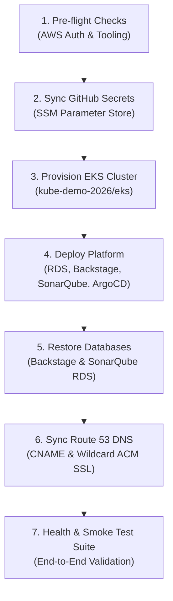

# Platform Disaster Recovery & Automated Re-Deploy

This skill provides complete automation and runbooks to rebuild and restore the entire Backstage IDP, Kubernetes EKS infrastructure, RDS databases, SonarQube QA, Grafana dashboards, ArgoCD applications, and GitHub integrations from scratch when an AWS demo account is wiped or replaced.

## Quick Start: One-Command Full Platform Restore

When a new AWS demo account is provisioned:

1. **Verify Prerequisites:**
   ```bash
   bash .agents/skills/platform-disaster-recovery/scripts/check-prerequisites.sh
   ```
   *Checks AWS authentication, GitHub CLI login, required binaries, and backup archive integrity.*

2. **Execute End-to-End Restore Pipeline:**
   ```bash
   bash .agents/skills/platform-disaster-recovery/scripts/full-restore.sh
   ```

3. **Verify Health and Workloads:**
   ```bash
   bash .agents/skills/platform-disaster-recovery/scripts/verify-health.sh
   ```

---

## Restoration Phases & Sequence



### Phase 1: Pre-flight Verification
Runs [`check-prerequisites.sh`](./scripts/check-prerequisites.sh) to ensure valid AWS STS credentials, GitHub CLI authentication, and checks the backup tarball located at `/home/ciro/backstate-infra/backup/latest-platform-backup.tar.gz`.

### Phase 2: Sychronize GitHub Secrets to AWS Parameter Store
Pushes the permanent credentials of the GitHub App (`backstage-devex-cirodasilvaj-2026`) and PAT into the AWS SSM Parameter Store of the new AWS account under `/backstage/github/*`.

### Phase 3: EKS Cluster Provisioning
Checks if `kube-demo-eks` is running. If not, initializes and applies the Terraform module in `/home/ciro/kube-demo-2026/eks` and configures `~/.kube/config`.

### Phase 4: Platform Deployment (Terraform & Manifests)
Applies `/home/ciro/backstate-infra/terraform`, which:
- Dynamically creates the remote state S3 bucket (`backstage-infra-tfstate-<ACCOUNT_ID>`).
- Deploys AWS RDS PostgreSQL multi-tenant instance.
- Deploys Backstage, SonarQube, Grafana, ArgoCD, and Fluentd.
- Automatically applies all ArgoCD Application manifests for:
  - `backstage`
  - `apps-demo-2026` (Python Flask & .NET 8 C#)
  - `bkstg-made-nodejs-demo22` (Node.js Hello World microservice)
  - `scaffolder-starter-microservice` (Scaffolder starter service)

### Phase 5: Database Restore
Extracts the latest backup tarball and restores the Backstage catalog entities and SonarQube quality gate history using [`/home/ciro/backstate-infra/scripts/restore-full-platform.sh`](file:///home/ciro/backstate-infra/scripts/restore-full-platform.sh). If running a fresh instance without manual restore, the container sidecar automatically seeds the catalog baseline from `/etc/backstage-db/schema.sql`.

### Phase 6: Route 53 DNS & ACM Certificate
Runs [`/home/ciro/backstate-infra/scripts/sync-dns-route53.sh`](file:///home/ciro/backstate-infra/scripts/sync-dns-route53.sh) to auto-discover the new public hosted zone (e.g. `*.realhandsonlabs.net`), issues a wildcard ACM certificate, and configures CNAME records.

### Phase 7: Health Verification
Runs [`verify-health.sh`](./scripts/verify-health.sh) to confirm HTTP 200 OK across:
- Backstage Web Portal & Catalog API
- SonarQube Quality Scanner Status (`{"status":"UP"}`)
- Grafana Observability Dashboards
- ArgoCD GitOps Controller
- Microservices live endpoints (`/api/info`)

---

## Detailed References
For in-depth architecture, secret specifications, and recovery diagrams, consult the [Disaster Recovery Guide](./references/disaster-recovery-guide.md).
