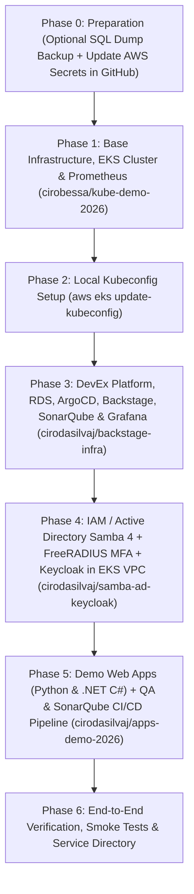

# Zero-to-Production Deployment Order Runbook (New 7-Hour AWS Account)

This document describes the **exact execution order** required to recreate the entire architecture from scratch when the 7-hour AWS sandbox account expires. Following this sequence guarantees that all network dependencies (VPC/Subnets), the EKS cluster, the RDS PostgreSQL database, the identity stack (Samba 4 AD + FreeRADIUS MFA + Keycloak), code quality/security (SonarQube), observability (Prometheus + Grafana), and sample applications come up cleanly without conflicts.

---

## Provisioning Order Overview



> [!TIP]
> **Automação One-Click Disponível:**
> Você pode executar todo o provisionamento de ponta a ponta com um único comando executando o script:
> ```bash
> ./scripts/redeploy-all.sh
> ```
> O script solicita as credenciais da nova conta AWS, sincroniza os secrets no GitHub, executa os pipelines na ordem correta e entrega o sumário final do AWS Parameter Store com todas as URLs e senhas.

---

## Phase 0 — Before the Old Account Expires (Optional) & Updating AWS Credentials

1. **(Optional — If the previous AWS account is still active)** Download the latest live PostgreSQL SQL dump from the Backstage endpoint using credentials from AWS Parameter Store:
   ```bash
   # Retrieve the Backstage password securely from AWS Parameter Store:
   # Parameter Name: /kube-demo-2026/platform/credentials
   # Parameter ARN:  arn:aws:ssm:us-east-1:<AWS_ACCOUNT_ID>:parameter/kube-demo-2026/platform/credentials
   BACKSTAGE_PASS=$(aws ssm get-parameter \
     --name "/kube-demo-2026/platform/credentials" \
     --with-decryption \
     --query "Parameter.Value" \
     --output text | jq -r '.credentials.backstage.password')

   curl -u "admin:${BACKSTAGE_PASS}" \
     -o /home/ciro/backstate-infra/db/schema.sql \
     http://<BACKSTAGE_ELB_HOSTNAME>/backstage-rds-dump.sql
   ```

2. **Update the new AWS account credentials** (`AWS_ACCESS_KEY_ID`, `AWS_SECRET_ACCESS_KEY`, `AWS_REGION=us-east-1`) locally and in the GitHub Actions Secrets of the repositories:
   ```bash
   export AWS_ACCESS_KEY_ID="YOUR_NEW_ACCESS_KEY_ID"
   export AWS_SECRET_ACCESS_KEY="YOUR_NEW_SECRET_ACCESS_KEY"
   export AWS_REGION="us-east-1"

   # 1. Update secrets in the EKS Cluster repository (cirobessa account)
   gh auth switch -u cirobessa
   gh secret set AWS_ACCESS_KEY_ID -b "$AWS_ACCESS_KEY_ID" -R cirobessa/kube-demo-2026
   gh secret set AWS_SECRET_ACCESS_KEY -b "$AWS_SECRET_ACCESS_KEY" -R cirobessa/kube-demo-2026
   gh secret set AWS_REGION -b "$AWS_REGION" -R cirobessa/kube-demo-2026

   # 2. Update secrets in the Platform, IAM, and Apps repositories (cirodasilvaj account)
   gh auth switch -u cirodasilvaj
   for repo in cirodasilvaj/backstage-infra cirodasilvaj/samba-ad-keycloak cirodasilvaj/apps-demo-2026; do
     gh secret set AWS_ACCESS_KEY_ID -b "$AWS_ACCESS_KEY_ID" -R "$repo"
     gh secret set AWS_SECRET_ACCESS_KEY -b "$AWS_SECRET_ACCESS_KEY" -R "$repo"
     gh secret set AWS_REGION -b "$AWS_REGION" -R "$repo"
   done
   ```

---

## Phase 1 — Base Infrastructure: VPC, Subnets, EKS Cluster, and Prometheus (`cirobessa/kube-demo-2026`)

Trigger the Terraform apply workflow for the EKS cluster:

```bash
gh auth switch -u cirobessa
gh workflow run eks.yml -R cirobessa/kube-demo-2026 -f action=apply
```

> **What this deploys:**
> - VPC (`10.0.0.0/16`) with 2 public subnets (`10.0.0.0/24`, `10.0.1.0/24`) and 2 private subnets (`10.0.10.0/24`, `10.0.11.0/24`).
> - Internet Gateway, NAT Gateway with Elastic IP, and route tables.
> - Amazon EKS Managed Cluster (v1.30) and Managed Node Group (2x `t3.medium` workers).
> - EKS Add-ons (`vpc-cni`, `coredns`, `kube-proxy`, `eks-pod-identity-agent`, `metrics-server`, `aws-mountpoint-s3-csi-driver`).
> - Prometheus Community Helm chart (v25.27.0) in the `monitoring` namespace.
> - **Route 53 & AWS ACM SSL/TLS:** Auto-descobre a conta AWS e a Hosted Zone (`*realhandsonlabs.net`), solicita o certificado Wildcard (`*.${domain}`) no AWS ACM e valida via DNS CNAME para habilitar HTTPS (porta 443) nos Load Balancers.
> - Estimated runtime: ~12 minutes.

---

## Phase 2 — Configure Local `kubectl`

Once the Phase 1 workflow finishes successfully, configure your local Kubernetes CLI:

```bash
aws eks update-kubeconfig --name kube-demo-eks --region us-east-1
kubectl get nodes -o wide
kubectl get pods -n kube-system
kubectl get pods -n monitoring
```

---

## Phase 3 — DevEx Platform, RDS Database, ArgoCD, SonarQube, and Grafana (`cirodasilvaj/backstage-infra`)

Trigger the DevEx platform infrastructure deployment:

```bash
gh auth switch -u cirodasilvaj
gh workflow run terraform.yml -R cirodasilvaj/backstage-infra -f action=apply
```

> **Note on Route 53 DNS Delegation:**
> Phase 3 automatically auto-discovers the ephemeral lab's Route 53 public hosted zone (`*realhandsonlabs.net`) via `terraform/dns.tf` and delegates friendly CNAME records:
> - `http://backstage.<lab-id>.realhandsonlabs.net`
> - `http://grafana.<lab-id>.realhandsonlabs.net`
> - `http://argocd.<lab-id>.realhandsonlabs.net`
> - `http://sonarqube.<lab-id>.realhandsonlabs.net`
> All URLs and credentials are automatically printed in the GitHub Actions Step Summary.
> Estimated runtime: ~5 minutes.

---

## Phase 4 — Active Directory (Samba 4 Multi-DC), FreeRADIUS MFA, and Keycloak (`cirodasilvaj/samba-ad-keycloak`)

Trigger the identity stack deployment:

```bash
gh auth switch -u cirodasilvaj
gh workflow run deploy.yml -R cirodasilvaj/samba-ad-keycloak -f action=apply
```

> **Note on Route 53 DNS & VPC Integration:**
> - Provisions EC2 instances (`samba_dc1`, `samba_dc2`, `keycloak`) directly inside the **EKS cluster VPC private subnets**.
> - Auto-discovers the lab's Route 53 hosted zone and registers:
>   - `ldap://ad.<lab-id>.realhandsonlabs.net:389` (Round-Robin DC1 & DC2)
>   - `http://sso.<lab-id>.realhandsonlabs.net` / `http://keycloak.<lab-id>.realhandsonlabs.net`
>   - `radius.<lab-id>.realhandsonlabs.net:1812` (MFA)
> - Outputs complete DNS connection strings and summary in the GitHub Actions step.
> Estimated runtime: ~4 minutes.

---

## Phase 5 — Demo Web Applications (Python & .NET C#) and QA/SonarQube CI/CD Pipeline (`cirodasilvaj/apps-demo-2026`)

Trigger the microservice build, scan, and deployment:

```bash
gh auth switch -u cirodasilvaj
gh workflow run build.yml -R cirodasilvaj/apps-demo-2026
```

> **Note on Route 53 DNS & Backstage Integration:**
> - Builds and deploys the Python Flask & .NET 8 C# sample microservices to EKS.
> - Auto-discovers the lab's Route 53 zone and assigns friendly CNAME records:
>   - `http://python.<lab-id>.realhandsonlabs.net`
>   - `http://dotnet.<lab-id>.realhandsonlabs.net`
> - Automatically displays live URLs in the Step Summary and catalogs them in Backstage.
> Estimated runtime: ~3 minutes.

---

## Phase 6 — End-to-End Verification & AWS Parameter Store (Single Source of Truth)

### 6.1 Centralized Credentials & Endpoints in AWS Parameter Store
Por motivos de conformidade e segurança da informação, **nenhuma credencial ou senha é exposta em texto plano nos logs dos deploys**. Em vez disso, todos os endpoints, URLs, certificados e credenciais são consolidados e criptografados em um único recurso no **AWS Systems Manager (SSM) Parameter Store**:

* **Nome do Recurso no Parameter Store:** `/kube-demo-2026/platform/credentials`
* **Tipo:** `SecureString` (Criptografia AWS KMS)
* **Comando AWS CLI para resgatar todos os endpoints e senhas:**
  ```bash
  aws ssm get-parameter \
    --name "/kube-demo-2026/platform/credentials" \
    --with-decryption \
    --query "Parameter.Value" \
    --output text | jq .
  ```

### 6.2 Estrutura do Payload Armazenado no Parameter Store

```json
{
  "metadata": {
    "project": "kube-demo-2026",
    "environment": "sandbox",
    "aws_account_id": "234824776462",
    "route53_domain": "234824776462.realhandsonlabs.net",
    "acm_cert_arn": "arn:aws:acm:us-east-1:234824776462:certificate/xxxx"
  },
  "endpoints_https": {
    "backstage": "https://backstage.234824776462.realhandsonlabs.net",
    "argocd": "https://argocd.234824776462.realhandsonlabs.net",
    "sonarqube": "https://sonarqube.234824776462.realhandsonlabs.net",
    "grafana": "https://grafana.234824776462.realhandsonlabs.net",
    "keycloak": "https://sso.234824776462.realhandsonlabs.net",
    "python_app": "https://python.234824776462.realhandsonlabs.net",
    "dotnet_app": "https://dotnet.234824776462.realhandsonlabs.net"
  },
  "endpoints_internal": {
    "samba_ad_ldap": "ldap://ad.234824776462.realhandsonlabs.net:389",
    "freeradius_mfa": "radius.234824776462.realhandsonlabs.net:1812",
    "prometheus_k8s": "http://prometheus-server.monitoring.svc.cluster.local:80",
    "rds_postgresql": "postgres-backstage.xxxx.us-east-1.rds.amazonaws.com:5432"
  },
  "credentials": {
    "backstage": { "username": "admin", "password": "..." },
    "sonarqube": { "username": "admin", "password": "..." },
    "grafana": { "username": "admin", "password": "..." },
    "argocd": { "username": "admin", "get_password_command": "..." },
    "samba_active_directory": { "realm": "lab.internal", "username": "Administrator", "password": "..." },
    "keycloak_sso": { "username": "admin", "password": "..." },
    "freeradius_mfa": { "shared_secret": "..." }
  }
}
```

### 6.3 Smoke Test dos Endpoints HTTPS
Execute este script para verificar a saúde dos endpoints sem expor senhas:

```bash
LAB_ID="YOUR_LAB_ID" # e.g. 829104
DOMAIN="${LAB_ID}.realhandsonlabs.net"

echo "==> Testing HTTP Endpoints..."
for svc in backstage argocd sonarqube grafana sso python dotnet; do
  STATUS=$(curl -s -o /dev/null -w "%{http_code}" --max-time 5 "http://${svc}.${DOMAIN}" || echo "FAIL")
  echo "  [${svc}] http://${svc}.${DOMAIN} -> HTTP ${STATUS}"
done

echo "==> Testing DNS Resolution..."
dig +short CNAME "backstage.${DOMAIN}"
dig +short A "ad.${DOMAIN}"
```
