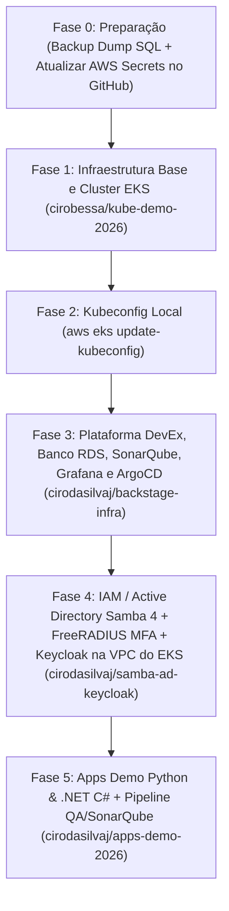

# Guia de Ordenação de Deploys do Zero (Nova Conta AWS 7 Horas)

Este documento descreve a **ordem exata de execução** para recriar toda a arquitetura do zero quando a conta de demonstração da AWS expirar, garantindo que todas as dependências de rede (VPC/Sub-redes), cluster EKS, banco RDS PostgreSQL, identidade (Samba 4 AD + FreeRADIUS MFA + Keycloak), qualidade/segurança (SonarQube), observabilidade (Prometheus + Grafana) e aplicações subam sem conflitos.

---

## Visão Geral da Ordem de Provisionamento



---

## Fase 0 — Antes da Conta Antiga Expirar (Opcional) e Atualização de Credenciais AWS

1. **(Se a conta anterior ainda estiver ativa)** Baixar o dump SQL atualizado do RDS PostgreSQL pelo endpoint do Backstage:
   ```bash
   curl -u admin:Backstage@2026 \
     -o /home/ciro/backstate-infra/db/schema.sql \
     http://<BACKSTAGE_ELB_HOSTNAME>/backstage-rds-dump.sql
   ```

2. **Atualizar as credenciais da nova conta AWS** (`AWS_ACCESS_KEY_ID`, `AWS_SECRET_ACCESS_KEY`, `AWS_REGION=us-east-1`) localmente e nos Secrets dos repositórios GitHub:
   ```bash
   export AWS_ACCESS_KEY_ID="SEU_NOVO_ACCESS_KEY"
   export AWS_SECRET_ACCESS_KEY="SEU_NOVO_SECRET_KEY"
   export AWS_REGION="us-east-1"

   # 1. Atualizar no repositório do Cluster EKS (conta cirobessa)
   gh auth switch -u cirobessa
   gh secret set AWS_ACCESS_KEY_ID -b "$AWS_ACCESS_KEY_ID" -R cirobessa/kube-demo-2026
   gh secret set AWS_SECRET_ACCESS_KEY -b "$AWS_SECRET_ACCESS_KEY" -R cirobessa/kube-demo-2026
   gh secret set AWS_REGION -b "$AWS_REGION" -R cirobessa/kube-demo-2026

   # 2. Atualizar nos repositórios da Plataforma e IAM (conta cirodasilvaj)
   gh auth switch -u cirodasilvaj
   for repo in cirodasilvaj/backstage-infra cirodasilvaj/samba-ad-keycloak; do
     gh secret set AWS_ACCESS_KEY_ID -b "$AWS_ACCESS_KEY_ID" -R "$repo"
     gh secret set AWS_SECRET_ACCESS_KEY -b "$AWS_SECRET_ACCESS_KEY" -R "$repo"
     gh secret set AWS_REGION -b "$AWS_REGION" -R "$repo"
   done
   ```

---

## Fase 1 — Infraestrutura Base: VPC, Sub-redes, Cluster EKS e Prometheus (`cirobessa/kube-demo-2026`)

```bash
gh auth switch -u cirobessa
gh workflow run terraform.yml -R cirobessa/kube-demo-2026 -f action=apply
```

---

## Fase 2 — Configurar o `kubectl` Local

```bash
aws eks update-kubeconfig --name kube-demo-eks --region us-east-1
kubectl get nodes
```

---

## Fase 3 — Plataforma DevEx, Banco RDS, ArgoCD, SonarQube e Grafana (`cirodasilvaj/backstage-infra`)

```bash
gh auth switch -u cirodasilvaj
gh workflow run terraform.yml -R cirodasilvaj/backstage-infra -f action=apply
```

---

## Fase 4 — Active Directory (Samba 4 Multi-DC), FreeRADIUS MFA e Keycloak (`cirodasilvaj/samba-ad-keycloak`)

```bash
gh auth switch -u cirodasilvaj
gh workflow run deploy.yml -R cirodasilvaj/samba-ad-keycloak -f action=apply
```

---

## Fase 5 — Aplicações Web Demo (Python & .NET C#) e Pipeline CI/CD com SonarQube (`cirodasilvaj/apps-demo-2026`)

```bash
gh auth switch -u cirodasilvaj
gh workflow run build.yml -R cirodasilvaj/apps-demo-2026
```
