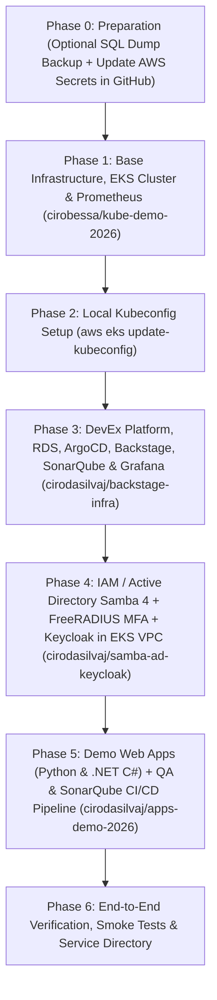

# Zero-to-Production Deployment Order Runbook (New 7-Hour AWS Account)

This document describes the **exact execution order** required to recreate the entire architecture from scratch when the 7-hour AWS sandbox account expires. Following this sequence guarantees that all network dependencies (VPC/Subnets), the EKS cluster, the RDS PostgreSQL database, the identity stack (Samba 4 AD + FreeRADIUS MFA + Keycloak), code quality/security (SonarQube), observability (Prometheus + Grafana), and sample applications come up cleanly without conflicts.

---

## Provisioning Order Overview



---

## Phase 0 — Before the Old Account Expires (Optional) & Updating AWS Credentials

1. **(Optional — If the previous AWS account is still active)** Download the latest live PostgreSQL SQL dump from the Backstage endpoint:
   ```bash
   curl -u admin:Backstage@2026 \
     -o /home/ciro/backstate-infra/db/schema.sql \
     http://<BACKSTAGE_ELB_HOSTNAME>/backstage-rds-dump.sql
   ```

2. **Update the new AWS account credentials** (`AWS_ACCESS_KEY_ID`, `AWS_SECRET_ACCESS_KEY`, `AWS_REGION=us-east-1`) locally and in the GitHub Actions Secrets of the repositories:
   ```bash
   export AWS_ACCESS_KEY_ID="YOUR_NEW_ACCESS_KEY_ID"
   export AWS_SECRET_ACCESS_KEY="YOUR_NEW_SECRET_ACCESS_KEY"
   export AWS_REGION="us-east-1"

   # 1. Update secrets in the EKS Cluster repository (cirobessa account)
   gh auth switch -u cirobessa
   gh secret set AWS_ACCESS_KEY_ID -b "$AWS_ACCESS_KEY_ID" -R cirobessa/kube-demo-2026
   gh secret set AWS_SECRET_ACCESS_KEY -b "$AWS_SECRET_ACCESS_KEY" -R cirobessa/kube-demo-2026
   gh secret set AWS_REGION -b "$AWS_REGION" -R cirobessa/kube-demo-2026

   # 2. Update secrets in the Platform, IAM, and Apps repositories (cirodasilvaj account)
   gh auth switch -u cirodasilvaj
   for repo in cirodasilvaj/backstage-infra cirodasilvaj/samba-ad-keycloak cirodasilvaj/apps-demo-2026; do
     gh secret set AWS_ACCESS_KEY_ID -b "$AWS_ACCESS_KEY_ID" -R "$repo"
     gh secret set AWS_SECRET_ACCESS_KEY -b "$AWS_SECRET_ACCESS_KEY" -R "$repo"
     gh secret set AWS_REGION -b "$AWS_REGION" -R "$repo"
   done
   ```

---

## Phase 1 — Base Infrastructure: VPC, Subnets, EKS Cluster, and Prometheus (`cirobessa/kube-demo-2026`)

Trigger the Terraform apply workflow for the EKS cluster:

```bash
gh auth switch -u cirobessa
gh workflow run eks.yml -R cirobessa/kube-demo-2026 -f action=apply
```

> **What this deploys:**
> - VPC (`10.0.0.0/16`) with 2 public subnets (`10.0.0.0/24`, `10.0.1.0/24`) and 2 private subnets (`10.0.10.0/24`, `10.0.11.0/24`).
> - Internet Gateway, NAT Gateway with Elastic IP, and route tables.
> - Amazon EKS Managed Cluster (v1.30) and Managed Node Group (2x `t3.medium` workers).
> - EKS Add-ons (`vpc-cni`, `coredns`, `kube-proxy`, `eks-pod-identity-agent`, `metrics-server`, `aws-mountpoint-s3-csi-driver`).
> - Prometheus Community Helm chart (v25.27.0) in the `monitoring` namespace.
> - Estimated runtime: ~12 minutes.

---

## Phase 2 — Configure Local `kubectl`

Once the Phase 1 workflow finishes successfully, configure your local Kubernetes CLI:

```bash
aws eks update-kubeconfig --name kube-demo-eks --region us-east-1
kubectl get nodes -o wide
kubectl get pods -n kube-system
kubectl get pods -n monitoring
```

---

## Phase 3 — DevEx Platform, RDS Database, ArgoCD, SonarQube, and Grafana (`cirodasilvaj/backstage-infra`)

Trigger the DevEx platform infrastructure deployment:

```bash
gh auth switch -u cirodasilvaj
gh workflow run terraform.yml -R cirodasilvaj/backstage-infra -f action=apply
```

> **Note on Route 53 DNS Delegation:**
> Phase 3 automatically auto-discovers the ephemeral lab's Route 53 public hosted zone (`*realhandsonlabs.net`) via `terraform/dns.tf` and delegates friendly CNAME records:
> - `http://backstage.<lab-id>.realhandsonlabs.net`
> - `http://grafana.<lab-id>.realhandsonlabs.net`
> - `http://argocd.<lab-id>.realhandsonlabs.net`
> - `http://sonarqube.<lab-id>.realhandsonlabs.net`
> All URLs and credentials are automatically printed in the GitHub Actions Step Summary.
> Estimated runtime: ~5 minutes.

---

## Phase 4 — Active Directory (Samba 4 Multi-DC), FreeRADIUS MFA, and Keycloak (`cirodasilvaj/samba-ad-keycloak`)

Trigger the identity stack deployment:

```bash
gh auth switch -u cirodasilvaj
gh workflow run deploy.yml -R cirodasilvaj/samba-ad-keycloak -f action=apply
```

> **Note on Route 53 DNS & VPC Integration:**
> - Provisions EC2 instances (`samba_dc1`, `samba_dc2`, `keycloak`) directly inside the **EKS cluster VPC private subnets**.
> - Auto-discovers the lab's Route 53 hosted zone and registers:
>   - `ldap://ad.<lab-id>.realhandsonlabs.net:389` (Round-Robin DC1 & DC2)
>   - `http://sso.<lab-id>.realhandsonlabs.net` / `http://keycloak.<lab-id>.realhandsonlabs.net`
>   - `radius.<lab-id>.realhandsonlabs.net:1812` (MFA)
> - Outputs complete DNS connection strings and summary in the GitHub Actions step.
> Estimated runtime: ~4 minutes.

---

## Phase 5 — Demo Web Applications (Python & .NET C#) and QA/SonarQube CI/CD Pipeline (`cirodasilvaj/apps-demo-2026`)

Trigger the microservice build, scan, and deployment:

```bash
gh auth switch -u cirodasilvaj
gh workflow run build.yml -R cirodasilvaj/apps-demo-2026
```

> **Note on Route 53 DNS & Backstage Integration:**
> - Builds and deploys the Python Flask & .NET 8 C# sample microservices to EKS.
> - Auto-discovers the lab's Route 53 zone and assigns friendly CNAME records:
>   - `http://python.<lab-id>.realhandsonlabs.net`
>   - `http://dotnet.<lab-id>.realhandsonlabs.net`
> - Automatically displays live URLs in the Step Summary and catalogs them in Backstage.
> Estimated runtime: ~3 minutes.

---

## Phase 6 — End-to-End Verification & Service Directory

### 6.1 Complete Endpoint Directory
Once all 5 phases conclude, test the live services using your sandbox `<lab-id>`:

| Service | Dynamic Route 53 URL | Default Credentials | Description |
|---|---|---|---|
| **Backstage IDP** | `http://backstage.<lab-id>.realhandsonlabs.net` | OAuth / SSO or Guest | Developer Portal, Software Catalog & TechDocs |
| **ArgoCD** | `http://argocd.<lab-id>.realhandsonlabs.net` | `admin` / *(fetched from secret)* | GitOps Application Controller UI |
| **SonarQube** | `http://sonarqube.<lab-id>.realhandsonlabs.net` | `admin` / `admin` | SAST Code Quality & Security Scanner |
| **Grafana** | `http://grafana.<lab-id>.realhandsonlabs.net` | `admin` / `admin` | Metrics Dashboards & Cluster Telemetry |
| **Keycloak SSO** | `http://sso.<lab-id>.realhandsonlabs.net` | `admin` / *(see secrets)* | Central IAM Broker (OIDC & SAML 2.0) |
| **Samba 4 AD** | `ldap://ad.<lab-id>.realhandsonlabs.net:389` | `Administrator` | Multi-DC Active Directory Directory Service |
| **Python API** | `http://python.<lab-id>.realhandsonlabs.net` | Public | Python 3.12 Flask Microservice (`/metrics`) |
| **.NET API** | `http://dotnet.<lab-id>.realhandsonlabs.net` | Public | .NET 8 C# Enterprise Microservice (`/healthz`) |

### 6.2 Smoke Test Commands
Run this verification snippet locally to confirm that all services are online:

```bash
LAB_ID="YOUR_LAB_ID" # e.g. 829104
DOMAIN="${LAB_ID}.realhandsonlabs.net"

echo "==> Testing HTTP Endpoints..."
for svc in backstage argocd sonarqube grafana sso python dotnet; do
  STATUS=$(curl -s -o /dev/null -w "%{http_code}" --max-time 5 "http://${svc}.${DOMAIN}" || echo "FAIL")
  echo "  [${svc}] http://${svc}.${DOMAIN} -> HTTP ${STATUS}"
done

echo "==> Testing DNS Resolution..."
dig +short CNAME "backstage.${DOMAIN}"
dig +short A "ad.${DOMAIN}"
```
