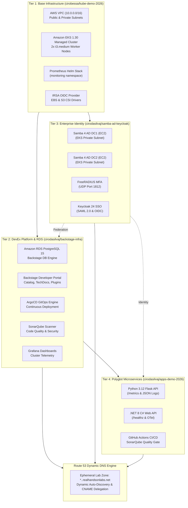

# Cloud Native Enterprise Platform on AWS EKS (`kube-demo-2026`)

[](https://www.terraform.io/)
[](https://kubernetes.io/)
[](https://aws.amazon.com/eks/)
[](https://prometheus.io/)
[](LICENSE)

High-resilience, production-grade cloud foundation on **Amazon Elastic Kubernetes Service (EKS)**. Engineered for rapid zero-to-production deployment, dynamic DNS auto-delegation, and disaster recovery within 7-hour ephemeral AWS sandbox environments.

This repository serves as **Tier 1 (Base Infrastructure)** of a unified 4-tier decoupled cloud-native architecture.

---

## Architecture Topology



---

## Decoupled 4-Tier Ecosystem Overview

| Tier | Repository | Owner | Purpose & Key Technologies |
|---|---|---|---|
| **Tier 1: Base Infra** | [**`cirobessa/kube-demo-2026`**](https://github.com/cirobessa/kube-demo-2026) *(this repo)* | `cirobessa` | AWS VPC (10.0.0.0/16), public/private subnets across 2 AZs, NAT Gateway, Amazon EKS 1.30 managed cluster, 2x `t3.medium` worker nodes, Prometheus Helm stack, and IRSA roles. |
| **Tier 2: DevEx Platform** | [**`cirodasilvaj/backstage-infra`**](https://github.com/cirodasilvaj/backstage-infra) | `cirodasilvaj` | Amazon RDS PostgreSQL 15, Backstage Developer Portal, ArgoCD GitOps engine, SonarQube SAST scanner, Grafana, and Route 53 dynamic CNAME delegation. |
| **Tier 3: Enterprise IAM** | [**`cirodasilvaj/samba-ad-keycloak`**](https://github.com/cirodasilvaj/samba-ad-keycloak) | `cirodasilvaj` | Dual Samba 4 Active Directory Domain Controllers (`samba_dc1` & `samba_dc2`) running inside the EKS VPC private subnets, FreeRADIUS MFA, and Keycloak 24 SSO (OIDC/SAML 2.0). |
| **Tier 4: Microservices** | [**`cirodasilvaj/apps-demo-2026`**](https://github.com/cirodasilvaj/apps-demo-2026) | `cirodasilvaj` | Polyglot microservices (Python 3.12 Flask + .NET 8 C# Web API), automated SonarQube quality gate pipeline, Route 53 CNAME delegation, and Backstage catalog integration. |

---

## Ephemeral Sandbox & Dynamic DNS Support

In 7-hour ephemeral AWS lab environments (*RealHandsOnLabs*, *A Cloud Guru*, *Cloud Academy*), accounts rotate continuously with random public Route 53 hosted zones:
```
*.<random-lab-id>.realhandsonlabs.net
```

Our Terraform modules and synchronization scripts auto-discover this hosted zone dynamically and delegate consistent, friendly CNAME records:

```
  • http://backstage.<lab-id>.realhandsonlabs.net   (Backstage IDP Portal)
  • http://argocd.<lab-id>.realhandsonlabs.net      (ArgoCD GitOps Dashboard)
  • http://sonarqube.<lab-id>.realhandsonlabs.net   (SonarQube Code Security)
  • http://grafana.<lab-id>.realhandsonlabs.net     (Grafana Metrics & Telemetry)
  • http://sso.<lab-id>.realhandsonlabs.net         (Keycloak 24 IAM Gateway)
  • ldap://ad.<lab-id>.realhandsonlabs.net:389      (Samba 4 AD LDAP Round-Robin)
  • http://python.<lab-id>.realhandsonlabs.net      (Python 3.12 Flask Microservice)
  • http://dotnet.<lab-id>.realhandsonlabs.net      (.NET 8 C# Enterprise API)
```

For complete implementation details, see [`docs/ROUTE53-DYNAMIC-DNS.md`](file:///home/ciro/kube-demo-2026/docs/ROUTE53-DYNAMIC-DNS.md).

---

## Zero-to-Production Recreation Playbook

When an AWS sandbox account expires, follow the deterministic 6-phase sequence below to re-provision the entire environment in **under 20 minutes**:

1. **Phase 0 (Credentials & Snapshot):** Rotate credentials in GitHub Actions Secrets across both accounts (`cirobessa` and `cirodasilvaj`). Optionally fetch live database SQL dump.
2. **Phase 1 (Base EKS):** Trigger workflow `eks.yml` on `cirobessa/kube-demo-2026` (`apply`).
3. **Phase 2 (Kubeconfig):** Run `aws eks update-kubeconfig --name kube-demo-eks --region us-east-1` locally and verify nodes.
4. **Phase 3 (Platform & DB):** Trigger workflow `terraform.yml` on `cirodasilvaj/backstage-infra` (`apply`).
5. **Phase 4 (Enterprise IAM):** Trigger workflow `deploy.yml` on `cirodasilvaj/samba-ad-keycloak` (`apply`).
6. **Phase 5 (Microservices):** Trigger workflow `build.yml` on `cirodasilvaj/apps-demo-2026`.
7. **Phase 6 (Verification):** Run smoke tests against the registered Route 53 service endpoints.

📖 **Full Step-by-Step Runbook:** Follow [`DEPLOY-ORDER-RUNBOOK.md`](file:///home/ciro/kube-demo-2026/DEPLOY-ORDER-RUNBOOK.md) for copy-paste CLI commands, secret management, and failure recovery.

---

## Complete Documentation Index

| Document | Description |
|---|---|
| 📦 [**`docs/GUIA-COMPLETO-DE-INSTALACOES-4-REPOSITORIOS.md`**](file:///home/ciro/kube-demo-2026/docs/GUIA-COMPLETO-DE-INSTALACOES-4-REPOSITORIOS.md) | **Guia Completo de Instalações:** Registro exaustivo de todos os componentes, add-ons, manifests, Helm charts, serviços de identidade e CI/CD nos 4 repositórios. |
| 📐 [**`docs/ARCHITECTURE.md`**](file:///home/ciro/kube-demo-2026/docs/ARCHITECTURE.md) | In-depth architectural blueprint covering VPC subnets, EKS 1.30, node groups, IRSA roles, and security groups. |
| 🌐 [**`docs/ROUTE53-DYNAMIC-DNS.md`**](file:///home/ciro/kube-demo-2026/docs/ROUTE53-DYNAMIC-DNS.md) | Detailed analysis and implementation of runtime Route 53 zone discovery and service CNAME delegation. |
| 🚀 [**`DEPLOY-ORDER-RUNBOOK.md`**](file:///home/ciro/kube-demo-2026/DEPLOY-ORDER-RUNBOOK.md) | Zero-to-production execution manual for recreating all 4 tiers from blank AWS credentials in < 20 min. |
| 🛡️ [**`docs/DISASTER-RECOVERY.md`**](file:///home/ciro/kube-demo-2026/docs/DISASTER-RECOVERY.md) | Business continuity protocols, RTO/RPO metrics, database rehydration, and S3 state locking. |
| 📊 [**`docs/OBSERVABILITY-AND-MONITORING.md`**](file:///home/ciro/kube-demo-2026/docs/OBSERVABILITY-AND-MONITORING.md) | Prometheus metrics scraping, Fluentd structured logging, Loki aggregation, and Grafana dashboards. |
| 🔑 [**`docs/IAM-AND-IDENTITY.md`**](file:///home/ciro/kube-demo-2026/docs/IAM-AND-IDENTITY.md) | Samba 4 Active Directory Multi-DC (in EKS VPC), FreeRADIUS MFA, and Keycloak SSO federation. |
| ⚙️ [**`docs/MICROSERVICES-AND-CICD.md`**](file:///home/ciro/kube-demo-2026/docs/MICROSERVICES-AND-CICD.md) | Polyglot apps (.NET 8 & Python 3.12), SonarQube SAST quality gates, and Backstage catalog integration. |
| 📑 [**`docs/PRESENTATION.md`**](file:///home/ciro/kube-demo-2026/docs/PRESENTATION.md) | Architecture slide deck transcript in Markdown format with speaker notes and diagrams. |

---

## PowerPoint Presentation (`.pptx`)

An executive widescreen 16:9 presentation deck has been generated:
- **Presentation File:** [`docs/kube-demo-2026-architecture.pptx`](file:///home/ciro/kube-demo-2026/docs/kube-demo-2026-architecture.pptx)
- **Slide Count:** 12 slides covering challenges, architecture tiers, networking, IAM, observability, and runbooks.
- **Generator Script:** [`scripts/generate_presentation.py`](file:///home/ciro/kube-demo-2026/scripts/generate_presentation.py)
  ```bash
  /home/ciro/.hermes/tools/python-3.14.9+20261021-linux-x64/bin/python3 scripts/generate_presentation.py
  ```

---

## Local Development & Quick Start

### Prerequisites
- Terraform >= 1.5
- AWS CLI v2 configured with active credentials
- `kubectl` >= 1.28
- Helm 3.x

### 1. Configure AWS Credentials
```bash
aws sts get-caller-identity
```

### 2. Initialize and Deploy Base EKS
```bash
cd eks
terraform init
terraform plan
terraform apply -auto-approve
```

### 3. Connect `kubectl`
```bash
aws eks update-kubeconfig --name kube-demo-eks --region us-east-1
kubectl get nodes
kubectl get pods -A
```

### 4. Tear Down Cluster
```bash
cd eks
terraform destroy -auto-approve
```

---

## Security Best Practices
- **Private Subnet Compute:** All worker nodes, databases, and Active Directory controllers operate in private subnets with NAT egress only.
- **Zero Hardcoded Secrets:** Credentials exist strictly in GitHub Actions Secrets and developer local credential stores (`~/.aws/`).
- **OIDC / IRSA Enforcement:** Pod access to AWS resources (CloudWatch, S3) is authenticated via short-lived STS tokens using IAM Roles for Service Accounts.
- **State Locking:** Remote state storage in Amazon S3 prevents concurrency collisions during CI/CD runs.
