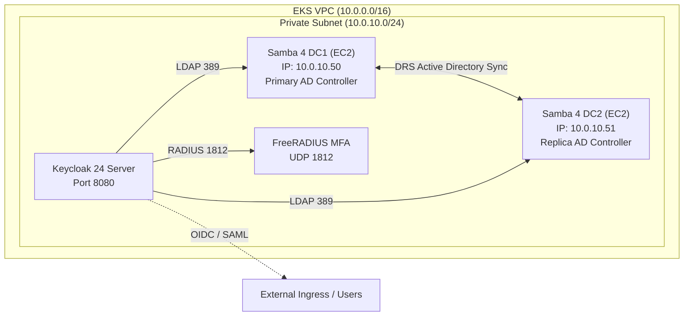

# Cloud Native Enterprise Platform Architecture Blueprint

This document specifies the complete system architecture for the Cloud Native Enterprise Platform running on **Amazon Elastic Kubernetes Service (EKS)** across a decoupled 4-repository topology, optimized for high-velocity operations and rapid re-provisioning in ephemeral AWS sandbox accounts.

---

## 1. High-Level System Architecture

The ecosystem is designed across four decoupled tiers, ensuring strict isolation between core networking, Kubernetes compute, developer platform tooling, enterprise identity, and application microservices.

```mermaid
flowchart TD
    subgraph AWS["AWS Cloud Environment (Ephemeral Sandbox Account)"]
        subgraph VPC["Virtual Private Cloud (10.0.0.0/16)"]
            subgraph PUB["Public Subnets (us-east-1a, us-east-1b)"]
                IGW["Internet Gateway"]
                NAT["NAT Gateway (Elastic IP)"]
                ELB_PUB["AWS Application / Network Load Balancers\n(Backstage, ArgoCD, SonarQube, Grafana, Microservices)"]
            end

            subgraph PRIV["Private Subnets (us-east-1a, us-east-1b)"]
                subgraph EKS_CLUSTER["Amazon EKS 1.30 Managed Cluster (kube-demo-eks)"]
                    MNG["Managed Node Group\n(2x t3.medium Workers)"]
                    
                    subgraph K8S_CORE["Core Add-ons"]
                        CNI["VPC-CNI"]
                        DNS_K8S["CoreDNS"]
                        PROXY["kube-proxy"]
                        POD_ID["Pod Identity Agent"]
                        METRICS["Metrics Server"]
                        S3_CSI["S3 Mountpoint CSI"]
                    end
                    
                    subgraph K8S_OBS["Observability Namespace"]
                        PROM["Prometheus Helm v25.27.0\n(/metrics scraping)"]
                    end
                    
                    subgraph K8S_PLATFORM["Platform Namespaces (DevEx)"]
                        BACKSTAGE["Backstage IDP Pods"]
                        ARGOCD["ArgoCD Controller & Server"]
                        SONAR["SonarQube SAST Scanner"]
                        GRAFANA["Grafana Dashboard Server"]
                    end
                    
                    subgraph K8S_APPS["Application Namespaces"]
                        PY_APP["Python 3.12 Flask API\n(Prometheus Exporter)"]
                        NET_APP[".NET 8 C# Web API\n(Healthz & OpenTelemetry)"]
                    end
                end

                subgraph RDS_LAYER["Platform Persistence"]
                    RDS_PG["Amazon RDS PostgreSQL 15\n(Backstage Relational Database)"]
                end

                subgraph IAM_LAYER["Enterprise Identity Tier (EC2 in EKS VPC)"]
                    DC1["Samba 4 AD DC1\n(EC2 - Primary DC)"]
                    DC2["Samba 4 AD DC2\n(EC2 - Replicated DC)"]
                    RADIUS["FreeRADIUS MFA\n(UDP Port 1812)"]
                    KEYCLOAK["Keycloak 24 IAM\n(SAML 2.0 / OIDC Gateway)"]
                end
            end
        end

        subgraph DNS_ENGINE["Route 53 Dynamic DNS Engine"]
            ZONE["Public Hosted Zone: *.<lab-id>.realhandsonlabs.net"]
            CNAME_BS["backstage.<lab-id>..."]
            CNAME_ARGO["argocd.<lab-id>..."]
            CNAME_SONAR["sonarqube.<lab-id>..."]
            CNAME_GRAF["grafana.<lab-id>..."]
            CNAME_KC["sso.<lab-id>... / keycloak.<lab-id>..."]
            CNAME_AD["ad.<lab-id>... (LDAP Round Robin)"]
            CNAME_PY["python.<lab-id>..."]
            CNAME_NET["dotnet.<lab-id>..."]
        end
    end

    IGW --> NAT
    NAT --> PRIV
    ELB_PUB --> K8S_PLATFORM
    ELB_PUB --> K8S_APPS
    ELB_PUB --> KEYCLOAK
    BACKSTAGE --> RDS_PG
    DC1 <-->|DRS Replication| DC2
    KEYCLOAK -->|User Federation (LDAP)| DC1 & DC2
    KEYCLOAK -->|MFA| RADIUS
    BACKSTAGE -. OIDC SSO .-> KEYCLOAK
    PY_APP & NET_APP -. Metrics .-> PROM
    PROM -. Datasource .-> GRAFANA
    ZONE --> CNAME_BS & CNAME_ARGO & CNAME_SONAR & CNAME_GRAF & CNAME_KC & CNAME_AD & CNAME_PY & CNAME_NET
```

---

## 2. Decoupled 4-Tier Repository Model

To ensure maintainability, clear ownership, and isolated blast radiuses, the platform is divided into four autonomous GitHub repositories:

| Tier | Repository | Owner | Technology Stack | Responsibility |
|---|---|---|---|---|
| **Tier 1: Base Infra** | [`cirobessa/kube-demo-2026`](https://github.com/cirobessa/kube-demo-2026) | `cirobessa` | Terraform, AWS EKS 1.30, VPC, Helm | VPC, Subnets, Internet/NAT Gateways, EKS Cluster, Node Groups, Prometheus Helm chart, IRSA roles. |
| **Tier 2: DevEx Platform** | [`cirodasilvaj/backstage-infra`](https://github.com/cirodasilvaj/backstage-infra) | `cirodasilvaj` | Terraform, Kubernetes, RDS PostgreSQL, ArgoCD, SonarQube, Grafana | Amazon RDS PostgreSQL, Backstage IDP, ArgoCD GitOps, SonarQube SAST, Grafana, Dynamic Route 53 CNAME delegation. |
| **Tier 3: Enterprise IAM** | [`cirodasilvaj/samba-ad-keycloak`](https://github.com/cirodasilvaj/samba-ad-keycloak) | `cirodasilvaj` | Terraform, EC2, Ansible, Samba 4, FreeRADIUS, Keycloak | Samba 4 Active Directory Multi-DC (DC1 & DC2) in EKS VPC, FreeRADIUS MFA, Keycloak SSO, dynamic DNS outputs. |
| **Tier 4: Microservices** | [`cirodasilvaj/apps-demo-2026`](https://github.com/cirodasilvaj/apps-demo-2026) | `cirodasilvaj` | Python 3.12, .NET 8 C#, Docker, GitHub Actions, SonarQube Scanner | Polyglot microservices, containerization, SonarQube quality gate pipeline, Route 53 CNAME delegation, Backstage catalog. |

---

## 3. Tier 1: Core Networking & Compute Architecture

### 3.1 VPC & Subnet Design
The network is deployed by Terraform in [`eks/vpc.tf`](file:///home/ciro/kube-demo-2026/eks/vpc.tf):
- **VPC CIDR:** `10.0.0.0/16`
- **DNS Attributes:** `enable_dns_support = true`, `enable_dns_hostnames = true`
- **Availability Zones:** 2 AZs in region `us-east-1` (dynamically selected via `data.aws_availability_zones.available`).
- **Subnet Allocation:**
  - `Public Subnet 0`: `10.0.0.0/24` (us-east-1a) — Houses NAT Gateway and public ELBs. Tagged `kubernetes.io/role/elb = 1`.
  - `Public Subnet 1`: `10.0.1.0/24` (us-east-1b) — Secondary public zone for ELB multi-AZ resilience. Tagged `kubernetes.io/role/elb = 1`.
  - `Private Subnet 0`: `10.0.10.0/24` (us-east-1a) — Houses EKS worker nodes, RDS, and AD EC2 instances. Tagged `kubernetes.io/role/internal-elb = 1`.
  - `Private Subnet 1`: `10.0.11.0/24` (us-east-1b) — Secondary private zone for compute and database failover. Tagged `kubernetes.io/role/internal-elb = 1`.
- **Egress Routing:**
  - Public Route Table routes `0.0.0.0/0` via the AWS Internet Gateway (`aws_internet_gateway.this`).
  - Private Route Table routes `0.0.0.0/0` via the AWS NAT Gateway (`aws_nat_gateway.this`), ensuring worker nodes have secure outbound internet access without being exposed to incoming public traffic.

### 3.2 Amazon EKS 1.30 Managed Cluster
Defined in [`eks/main.tf`](file:///home/ciro/kube-demo-2026/eks/main.tf):
- **Kubernetes Version:** `1.30`
- **API Endpoint:** Public & Private access enabled.
- **Worker Node Group:**
  - Capacity: Fixed at 2 nodes (`min = 2`, `desired = 2`, `max = 2`).
  - Instance Type: `t3.medium` (2 vCPU, 4 GiB RAM) — optimized for cost while comfortably scheduling platform workloads.
  - Subnet Association: Attached exclusively to the private subnets.
- **IAM Identity & IRSA (IAM Roles for Service Accounts):**
  - An OpenID Connect (OIDC) identity provider is registered for the cluster (`aws_iam_openid_connect_provider.eks`).
  - Dedicated IAM roles with Web Identity federation:
    - `fluentd-logging-role`: Allows Fluentd pods to stream logs to Amazon CloudWatch or S3.
    - `s3-csi-driver-role`: Permits the AWS Mountpoint S3 CSI driver to mount object storage volumes into Kubernetes pods.

### 3.3 Managed Cluster Add-ons
Configured in [`eks/addons.tf`](file:///home/ciro/kube-demo-2026/eks/addons.tf):
1. **`vpc-cni`:** Delivers native AWS VPC networking for pods by allocating ENI secondary IP addresses.
2. **`coredns`:** Internal cluster DNS name resolution.
3. **`kube-proxy`:** IPVS/iptables packet routing for Kubernetes Services.
4. **`eks-pod-identity-agent`:** AWS Pod Identity mechanism for frictionless token exchange.
5. **`metrics-server`:** Lightweight resource metrics collection for `kubectl top` and Horizontal Pod Autoscalers.
6. **`aws-mountpoint-s3-csi-driver`:** S3 bucket CSI volume mounting for persistent or shared object storage.

### 3.4 Cluster Telemetry (Prometheus)
Provisioned in [`eks/prometheus.tf`](file:///home/ciro/kube-demo-2026/eks/prometheus.tf):
- Deployed via official Prometheus Community Helm chart (`v25.27.0`) into dedicated `monitoring` namespace.
- Persistent volumes are disabled (`server.persistentVolume.enabled = false`) to fit the ephemeral nature of the sandbox and eliminate unneeded EBS volume attachments.
- Exposes cluster-wide metrics at `http://prometheus-server.monitoring.svc.cluster.local`.

---

## 4. Tier 2: DevEx Platform & Database (`backstage-infra`)

### 4.1 Backstage Developer Portal
- Serves as the central interface for software components, technical documentation (TechDocs), system dependency graphs, and CI/CD status.
- Integrates pre-installed plugins:
  - **Kubernetes Plugin:** Inspects live pod status, deployments, and replica counts on the EKS cluster.
  - **SonarQube Plugin:** Visualizes code analysis, test coverage, code smells, and quality gate results.
  - **ArgoCD Plugin:** Displays GitOps application sync state and health.
  - **Prometheus & Grafana:** Embedded telemetry dashboards.

### 4.2 Relational Database (RDS PostgreSQL 15)
- Backstage requires relational storage for its catalog, user profiles, search indices, and plugin states.
- Provisioned as an **Amazon RDS PostgreSQL 15** instance within the EKS private subnets.
- **Schema Rehydration & Seeding:**
  - Upon initialization, `db/schema.sql` automatically populates default catalog entities and relations.
  - Disaster Recovery snapshot dump is accessible via HTTP endpoint (`/backstage-rds-dump.sql`) for export prior to account expiration.

### 4.3 ArgoCD GitOps
- Runs inside Kubernetes to implement declarative continuous delivery.
- Monitors Git repositories for manifest changes and synchronizes the desired state to the cluster.

### 4.4 SonarQube Scanner Server
- Static Application Security Testing (SAST) platform.
- Performs code quality analysis, vulnerability scanning, security hotspot detection, and test coverage evaluation for microservices.

---

## 5. Tier 3: Enterprise IAM & Multi-DC Active Directory (`samba-ad-keycloak`)

### 5.1 Architecture within EKS VPC
To avoid cross-VPC peering overhead and latency, the IAM EC2 instances are provisioned directly in the **EKS cluster's private subnets**:



### 5.2 Key Features
1. **Samba 4 Active Directory Multi-DC:**
   - Redundant domain controllers (`samba_dc1` and `samba_dc2`) providing Active Directory Domain Services (AD DS).
   - Bi-directional Directory Replication Service (DRS) synchronizes objects, groups, and password hashes.
   - Internal Samba DNS server is explicitly disabled (`--dns-backend=NONE`) to prevent conflicts with AWS Route 53 and CoreDNS.
2. **FreeRADIUS Multi-Factor Authentication (MFA):**
   - Configured on UDP port 1812 to provide secondary authentication tokens (TOTP / OTP).
3. **Keycloak 24 IAM Gateway:**
   - Centralized identity broker supporting OpenID Connect (OIDC) and SAML 2.0.
   - User Federation module syncs Active Directory users and groups directly over LDAP.
   - Issues JSON Web Tokens (JWT) for Backstage portal logins and microservice authorization.

---

## 6. Tier 4: Polyglot Microservices (`apps-demo-2026`)

### 6.1 Python 3.12 Flask Microservice
- Lightweight RESTful API built with Python 3.12 and Flask blueprints.
- **Instrumentation:**
  - `prometheus_client` exporter exposes `/metrics` for real-time scraping.
  - Formatted JSON logging facilitates structured ingestion by Fluentd and Loki.
- **Backstage Integration:**
  - Includes [`catalog-info.yaml`](https://github.com/cirodasilvaj/apps-demo-2026/blob/main/python-app/catalog-info.yaml) registering the component, its system, API dependencies, SonarQube project key, and Grafana dashboard URLs.

### 6.2 .NET 8 C# Enterprise Microservice
- High-throughput Web API developed with ASP.NET Core 8.
- **Health Checks & Telemetry:**
  - Standard Kubernetes liveness and readiness probes configured at `/healthz`.
  - Built-in OpenTelemetry metrics and tracing.
- **Backstage Integration:**
  - Includes dedicated [`catalog-info.yaml`](https://github.com/cirodasilvaj/apps-demo-2026/blob/main/dotnet-csharp-app/catalog-info.yaml) with complete entity specifications.

### 6.3 Automated CI/CD & SonarQube Quality Gate
- GitHub Actions workflow (`.github/workflows/build.yml`) automates:
  1. Unit and integration test execution.
  2. SonarQube code scanning with automated quality gate evaluation.
  3. Container image build and push.
  4. Kubernetes rolling deployment and Route 53 CNAME dynamic association.

---

## 7. Dynamic Route 53 DNS Engine

Ephemeral AWS sandbox accounts provide a pre-created Route 53 public hosted zone with a dynamically generated domain format:
```
*.<random-account-id>.realhandsonlabs.net
```

### 7.1 Auto-Discovery Implementation
Rather than hardcoding domain names, Terraform queries AWS dynamically:
```hcl
data "aws_route53_zone" "lab" {
  name         = "realhandsonlabs.net."
  private_zone = false
}
```

From this zone, Terraform parses the domain name and dynamically creates canonical CNAME and A records:

| Service Subdomain | Record Type | Target Destination | Purpose |
|---|---|---|---|
| `backstage.<lab-id>...` | CNAME | AWS ELB Hostname | Backstage Developer Portal Web UI |
| `argocd.<lab-id>...` | CNAME | AWS ELB Hostname | ArgoCD GitOps Dashboard |
| `sonarqube.<lab-id>...` | CNAME | AWS ELB Hostname | SonarQube SAST Scanner UI |
| `grafana.<lab-id>...` | CNAME | AWS ELB Hostname | Grafana Metrics & Dashboards |
| `sso.<lab-id>...` / `keycloak.<lab-id>...` | CNAME | AWS ELB Hostname | Keycloak OIDC / SAML Auth Gateway |
| `ad.<lab-id>...` | A (Round-Robin) | EC2 Private IPs (`10.0.10.50`, `10.0.10.51`) | Samba 4 Active Directory LDAP (Port 389) |
| `radius.<lab-id>...` | A | EC2 Private IP | FreeRADIUS MFA Server (UDP 1812) |
| `python.<lab-id>...` | CNAME | AWS ELB Hostname | Python 3.12 Flask Microservice API |
| `dotnet.<lab-id>...` | CNAME | AWS ELB Hostname | .NET 8 C# Enterprise Microservice API |

---

## 8. Security & Compliance Architecture

1. **Network Segmentation:**
   - All compute nodes, databases, and Active Directory servers reside exclusively inside private subnets (`10.0.10.0/24`, `10.0.11.0/24`).
   - Only internet-facing Load Balancers and the NAT Gateway reside in public subnets (`10.0.0.0/24`, `10.0.1.0/24`).
2. **Least Privilege IAM Roles:**
   - No long-lived AWS secret access keys inside cluster workloads.
   - All pod-to-AWS communication is governed via AWS IAM Roles for Service Accounts (IRSA) with scoped policies.
3. **Container Security:**
   - Microservices run as non-root unprivileged users inside minimal container base images (Alpine / Distroless).
   - SonarQube quality gates prevent code containing high-severity CVEs or security hotspots from being deployed.
4. **State Protection & Idempotency:**
   - Terraform S3 backend with native state locking prevents concurrent pipeline runs.
   - Zero-touch automated redeployment capability guarantees recovery from clean-slate accounts in under 20 minutes.
