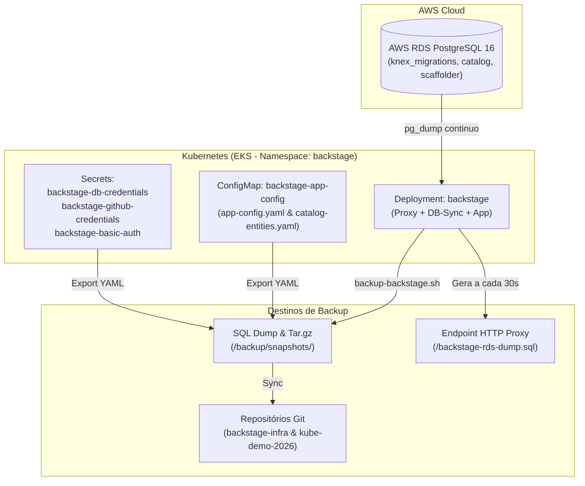

# Procedimento Operacional: Backup e Restauração do Backstage Developer Portal

> **Objetivo:** Estabelecer o procedimento oficial de backup e recuperação de desastres (Disaster Recovery - DR) para as configurações, banco de dados e estado do **Backstage Developer Portal**.
> **Data de Atualização:** 01/11/2026
> **Escopo:** Banco de dados PostgreSQL 16 (AWS RDS), ConfigMaps, Secrets, RBAC, Manifestos Kubernetes e Metadados do Catálogo.

---

## 1. Visão Geral da Arquitetura de Backup

O Backstage mantém suas configurações e estado distribuídos em três camadas principais:



1. **Estado do Catálogo e Plugins (AWS RDS PostgreSQL 16):**
   - Tabelas de migração (`knex_migrations`).
   - Entidades e relacionamentos (`final_entities`, `entities`, `relations`).
   - Estado de sincronização com o GitHub (`refresh_state`).
   - Tarefas e logs do Scaffolder (`scaffolder_tasks`).
2. **Configurações da Aplicação (Kubernetes ConfigMap):**
   - `app-config.yaml`: Conexões, integrações GitHub, regras de catálogo, plugins.
   - `catalog-entities.yaml`: Usuários e Grupos base (`guest`, `platform-team`).
3. **Credenciais e Chaves de Integração (Kubernetes Secrets):**
   - `backstage-db-credentials`: Acesso ao RDS PostgreSQL.
   - `backstage-github-credentials`: Token PAT / GitHub App da conta `cirodasilvaj`.
   - `backstage-basic-auth`: Credenciais do proxy reverso Nginx.

---

## 2. Métodos de Backup Disponíveis

### Método A: Backup Automatizado em Background (Zero Intervenção)
O container auxiliar `backstage-db-sync` executa continuamente no pod do Backstage:
- **Periodicidade:** A cada 30 segundos.
- **Ação:** Executa `pg_dump` no RDS com as flags `--clean --if-exists --no-owner --no-privileges --inserts`.
- **Localização:** Armazenado no volume compartilhado em `/usr/share/nginx/html/dumps/backstage-rds-dump.sql`.
- **Download Direto via HTTP (com autenticação básica):**
  ```bash
  curl -fsS -u admin:Backstage@2026 http://backstage.<dominio>/backstage-rds-dump.sql -o backstage-rds-dump.sql
  ```

---

### Método B: Backup Sob Demanda via Script Automatizado (Recomendado)
Para gerar um snapshot completo (Banco + Manifestos K8s + Checksums SHA256):

```bash
# Executar a partir da raiz do repositório backstage-infra ou kube-demo-2026:
./scripts/backup-backstage.sh
```

**O que o script executa:**
1. Conecta-se ao RDS PostgreSQL e extrai o dump SQL completo com validação de tabelas críticas.
2. Exporta todos os manifestos Kubernetes do Backstage (`ConfigMap`, `Deployment`, `Service`, `ServiceAccount`, `ClusterRole`, `ClusterRoleBinding`).
3. Exporta o status do cluster EKS (`k8s-cluster-status.json`).
4. Gera arquivo de metadados `BACKUP_METADATA.json` com estatísticas do catálogo.
5. Calcula hashes SHA256 (`SHA256SUMS`) para garantia de integridade.
6. Cria um pacote compactado em `backup/backstage-backup-<timestamp>.tar.gz`.
7. Atualiza os arquivos de backup nos repositórios:
   - `backstage-infra/db/live-backup.sql`
   - `kube-demo-2026/backup/backstage-rds-dump.sql`

---

## 3. Procedimento de Restauração (Disaster Recovery)

Em caso de corrupção de banco, falha na conta AWS ou recriação do cluster:

### Passo 1: Obter o Snapshot de Backup
Localize o arquivo de dump mais recente:
```bash
LATEST_DUMP="/home/ciro/backstate-infra/db/live-backup.sql"
# Ou a partir de um arquivo compactado:
# tar -xzf /home/ciro/backstate-infra/backup/backstage-backup-*.tar.gz
```

### Passo 2: Restaurar o Banco de Dados no AWS RDS
Se o pod do Backstage estiver ativo, restaure diretamente via container auxiliar:
```bash
kubectl exec -i -n backstage deployment/backstage -c backstage-db-sync -- sh -c \
  'PGPASSWORD="$POSTGRES_PASSWORD" psql -h "$POSTGRES_HOST" -p "$POSTGRES_PORT" -U "$POSTGRES_USER" -d "$POSTGRES_DB"' \
  < "${LATEST_DUMP}"
```

Se o cluster estiver sendo provisionado do zero via máquina local com acesso de rede ao RDS:
```bash
export PGPASSWORD="<senha-do-rds>"
psql -h "<rds-endpoint>" -p 5432 -U "backstage" -d "postgres" < "${LATEST_DUMP}"
```

### Passo 3: Aplicar as Configurações do Kubernetes
```bash
# Aplicar Namespace, RBAC, ConfigMap e Secrets
kubectl apply -f /home/ciro/backstate-infra/k8s-manifests/backstage/namespace.yaml
kubectl apply -f /home/ciro/backstate-infra/k8s-manifests/backstage/rbac.yaml
kubectl apply -f /home/ciro/backstate-infra/k8s-manifests/backstage/configmap-app-config.yaml
kubectl apply -f /home/ciro/backstate-infra/k8s-manifests/backstage/service.yaml
kubectl apply -f /home/ciro/backstate-infra/k8s-manifests/backstage/deployment.yaml
```

### Passo 4: Reiniciar e Validar o Rollout do Backstage
```bash
kubectl rollout restart deployment backstage -n backstage
kubectl rollout status deployment backstage -n backstage --timeout=180s
```

### Passo 5: Validação da Integridade Pós-Restauração
Verifique se as entidades e integrações estão 100% operacionais:
```bash
# 1. Verificar se a API do Catálogo responde 200 OK com todas as entidades
curl -s -u admin:Backstage@2026 http://backstage.<dominio>/api/catalog/entities | jq '. | length'

# 2. Verificar o status de saúde do backend
curl -s -u admin:Backstage@2026 http://backstage.<dominio>/healthcheck

# 3. Validar componente python-demo-app
curl -s -u admin:Backstage@2026 http://backstage.<dominio>/api/catalog/entities/by-name/component/default/python-demo-app | jq .metadata.name
```
