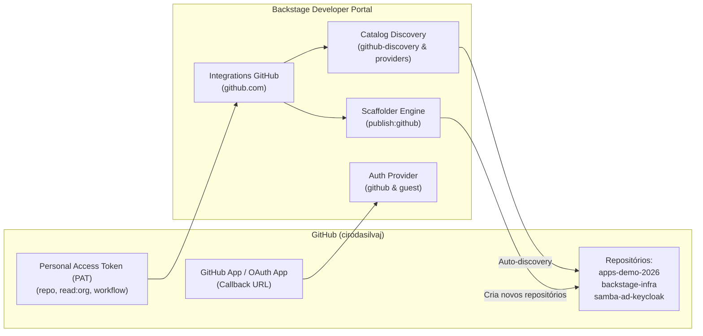

# Guia de Integração: Backstage com GitHub (`cirodasilvaj`)

> **Objetivo:** Documentar a integração completa do Backstage Developer Portal com a conta do GitHub **`cirodasilvaj`**, abrangendo autenticação de usuários (OAuth/GitHub App), leitura de catálogo (Discovery Processor & Providers), publicação automatizada via Scaffolder Templates e visualização de pipelines CI/CD.
> **Data de Atualização:** 01/11/2026
> **Conta GitHub Vinculada:** [`cirodasilvaj`](https://github.com/cirodasilvaj)
> **Endpoint do Portal:** `http://backstage.799416476486.realhandsonlabs.net`

---

## 1. Visão Geral da Integração

A integração do Backstage com o GitHub na conta `cirodasilvaj` é composta por 4 pilares:



---

## 2. Configurações Ativas no Ambiente

### 2.1. Credenciais no Kubernetes (Namespace: `backstage`)
As credenciais estão armazenadas no Secret `backstage-github-credentials`:
* **`token`**: Token PAT ativo da conta `cirodasilvaj` com escopos `repo`, `workflow`, `read:org`.
* **Variáveis no container:**
  - `GITHUB_TOKEN`: Exportado para o backend do Backstage.
  - `GITHUB_APP_CLIENT_ID`: (Opcional, para login via OAuth/GitHub App).
  - `GITHUB_APP_CLIENT_SECRET`: (Opcional, para login via OAuth/GitHub App).
  - `GITHUB_APP_ID`: (Opcional, para autenticação corporativa via GitHub App).
  - `GITHUB_APP_PRIVATE_KEY`: (Opcional, chave privada `.pem`).

### 2.2. Integração no `app-config.yaml`
```yaml
integrations:
  github:
    - host: github.com
      token: ${GITHUB_TOKEN}

scaffolder:
  defaultAuthor:
    name: Backstage Scaffolder
    email: platform-team@empresa.local
  defaultCommitMessage: "feat: initial service scaffold from Backstage template"
```

### 2.3. Descoberta Automática de Catálogo (Discovery & Providers)
O portal monitora automaticamente todos os repositórios da conta `cirodasilvaj`:
```yaml
catalog:
  rules:
    - allow: [Component, System, API, Resource, Location, Group, User, Template]
  providers:
    github:
      cirodasilvaj:
        organization: 'cirodasilvaj'
        catalogPath: '/catalog-info.yaml'
        filters:
          branch: 'main'
          repository: '.*'
        schedule:
          frequency: { minutes: 15 }
          timeout: { minutes: 3 }
  locations:
    - type: github-discovery
      target: https://github.com/cirodasilvaj/*/blob/main/catalog-info.yaml
```

---

## 3. Passo a Passo: Ativação de Login via GitHub (OAuth / GitHub App)

O portal suporta login simultâneo como **Guest** (desenvolvimento) e **GitHub** (autenticação real). Para ativar o botão de login com o GitHub:

### Opção A: Via GitHub OAuth App (Rápida - 2 minutos)
1. Acesse: [GitHub Settings > Developer settings > OAuth Apps > New OAuth App](https://github.com/settings/applications/new).
2. Preencha as informações:
   * **Application name:** `Backstage DevEx - cirodasilvaj`
   * **Homepage URL:** `http://backstage.799416476486.realhandsonlabs.net`
   * **Authorization callback URL:** `http://backstage.799416476486.realhandsonlabs.net/api/auth/github/handler/frame`
3. Clique em **Register application**.
4. Copie o **Client ID** e gere um **Client Secret**.
5. Atualize o Secret no cluster Kubernetes:
   ```bash
   kubectl set data secret/backstage-github-credentials -n backstage \
     client_id="$(echo -n 'SEU_CLIENT_ID' | base64)" \
     client_secret="$(echo -n 'SEU_CLIENT_SECRET' | base64)"
   
   kubectl rollout restart deployment backstage -n backstage
   ```

---

### Opção B: Via GitHub App (Recomendada para Produção)
1. Acesse: [GitHub Settings > Developer settings > GitHub Apps > New GitHub App](https://github.com/settings/apps/new).
2. Preencha:
   * **GitHub App name:** `Backstage-Platform-cirodasilvaj`
   * **Homepage URL:** `http://backstage.799416476486.realhandsonlabs.net`
   * **Callback URL:** `http://backstage.799416476486.realhandsonlabs.net/api/auth/github/handler/frame`
   * **Webhook:** Desmarque **Active**.
3. Permissões de Repositório (**Repository permissions**):
   * **Contents:** `Read & write` (permite publicação de templates pelo Scaffolder).
   * **Metadata:** `Read-only`.
   * **Pull requests:** `Read & write`.
   * **Workflows / Actions:** `Read-only`.
4. Clique em **Create GitHub App**.
5. Gere uma **Private Key** (baixe o arquivo `.pem`) e anote o **App ID**, **Client ID** e gere o **Client Secret**.
6. Instale o App na conta `cirodasilvaj` (**Install App**).
7. Configure o Secret no cluster Kubernetes:
   ```bash
   kubectl set data secret/backstage-github-credentials -n backstage \
     app_id="$(echo -n 'SEU_APP_ID' | base64)" \
     client_id="$(echo -n 'SEU_CLIENT_ID' | base64)" \
     client_secret="$(echo -n 'SEU_CLIENT_SECRET' | base64)" \
     private_key="$(base64 -w 0 chave.pem)"
   
   kubectl rollout restart deployment backstage -n backstage
   ```

---

## 4. Como Testar e Validar

1. **Validação da Integração de Catálogo:**
   ```bash
   curl -s -u admin:Backstage@2026 http://backstage.799416476486.realhandsonlabs.net/api/catalog/entities | jq '. | length'
   ```
2. **Criação de Repositório via Template (Scaffolder):**
   * Acesse `http://backstage.799416476486.realhandsonlabs.net/create`.
   * Escolha o template `Standard Microservice with CI/CD`.
   * Mantenha `destinationOwner: cirodasilvaj`.
   * Preencha o nome do repositório (ex: `teste-scaffolder-01`).
   * Clique em **Create**: o Backstage criará o repositório no seu GitHub, adicionará o workflow do GitHub Actions e registrará automaticamente no catálogo!
