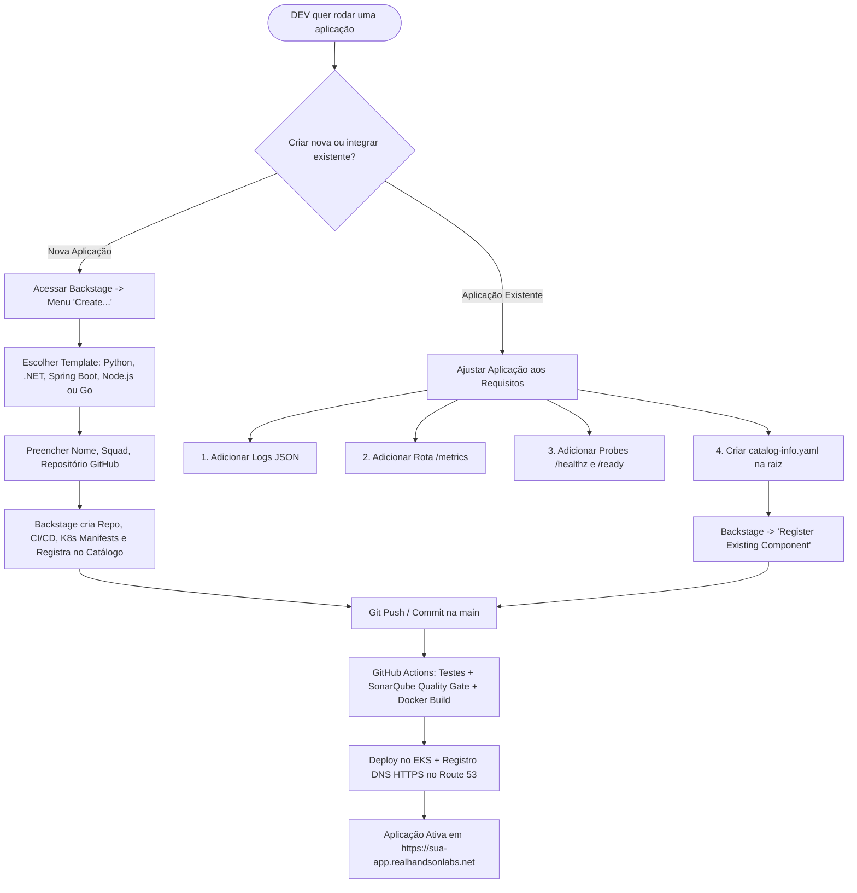
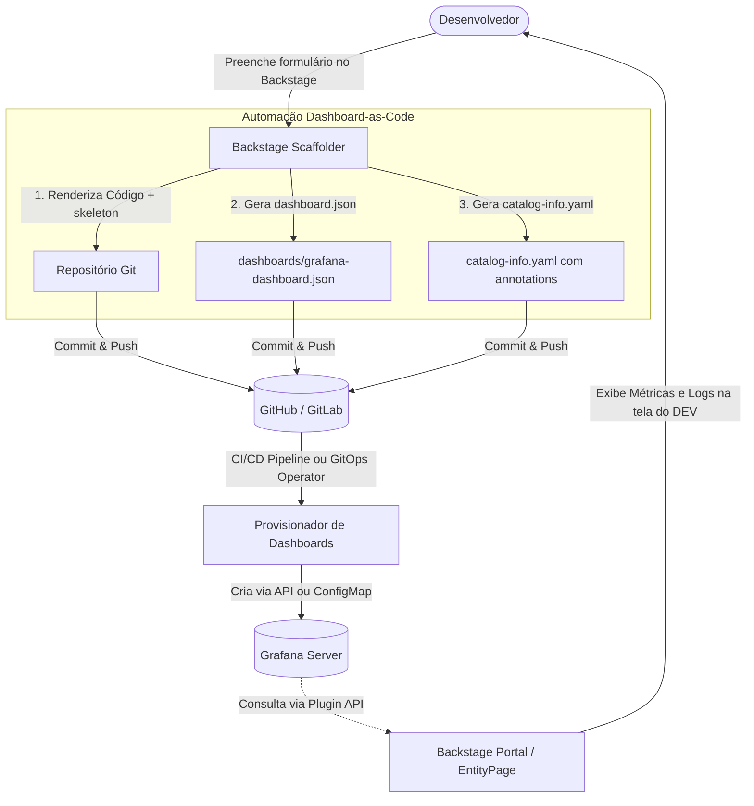

# Roadmap & Guia de Onboarding do Desenvolvedor no Backstage

Bem-vindo à plataforma de engenharia de software corporativa! Este guia fornece o passo a passo completo para você, **desenvolvedor (DEV)**, fazer o onboarding da sua aplicação no **Backstage**, atender aos requisitos de observabilidade (logs e métricas), segurança de código (SonarQube) e colocar sua aplicação no ar no cluster **Amazon EKS** com **HTTPS** e **DNS dinâmico**.

---

## Sumário
1. [Visão Geral da Plataforma](#1-visão-geral-da-plataforma)
2. [Caminhos de Onboarding: Nova Aplicação vs. Aplicação Existente](#2-caminhos-de-onboarding)
   * [Opção A: Criar Nova Aplicação via Software Templates (Scaffolder)](#opção-a-criar-nova-aplicação-via-templates-recomendado)
   * [Opção B: Integrar um Repositório Existente](#opção-b-integrar-um-repositório-existente)
3. [Requisitos Mandatórios da Aplicação para Rodar no Ambiente](#3-requisitos-mandatórios-da-aplicação)
   * [3.1 Logs Estruturados em JSON (Fluentd -> Loki)](#31-padrão-de-logs-estruturados-em-json)
   * [3.2 Métricas de Telemetria (Prometheus & Grafana)](#32-exposição-de-métricas-para-o-prometheus)
   * [3.3 Health Checks e Probes de Saúde (Kubernetes)](#33-health-checks-liveness-e-readiness)
   * [3.4 Labels e Tags de Governança (FinOps & CNCF)](#34-labels-mandatórias-de-governança-e-finops)
   * [3.5 Qualidade e Segurança de Código (SonarQube Quality Gate)](#35-qualidade-de-código-e-sonarqube-quality-gate)
   * [3.6 Rede, DNS Dinâmico e Certificado HTTPS (Route 53 & ACM)](#36-rede-dns-dinâmico-e-https-acm)
   * [3.7 Estratégia de Observabilidade: Mínimo de Dashboards (Backstage + Grafana Dashboard-as-Code)](#37-estratégia-de-observabilidade-mínimo-de-dashboards-backstage--grafana-dashboard-as-code)
4. [Anatomia Completa do `catalog-info.yaml`](#4-anatomia-completa-do-catalog-infoyaml)
5. [Checklist do Desenvolvedor (Definition of Done)](#5-checklist-do-desenvolvedor-definition-of-done)

---

## 1. Visão Geral da Plataforma

O **Backstage** é o seu Portal do Desenvolvedor (IDP). A partir dele, você tem acesso unificado a:
* **Catálogo de Software:** Visualização de todos os serviços, squads donas, APIs e dependências.
* **TechDocs:** Documentação técnica centralizada escrita em Markdown no próprio repositório.
* **Plugins de Observabilidade:** Dashboards do Grafana e métricas do Prometheus embebidos na página do seu componente.
* **Segurança e Qualidade:** Resultados de scans de segurança, bugs e cobertura de testes do SonarQube.
* **GitOps & Kubernetes:** Status em tempo real dos Pods no EKS e sincronismo via ArgoCD.

> **URLs de Acesso ao Ambiente:**
> * **Backstage:** `https://backstage.<lab-id>.realhandsonlabs.net` (ou `http://...`)
> * **SonarQube:** `https://sonarqube.<lab-id>.realhandsonlabs.net`
> * **Grafana:** `https://grafana.<lab-id>.realhandsonlabs.net`
> * **ArgoCD:** `https://argocd.<lab-id>.realhandsonlabs.net`
>
> 🔒 **Credenciais Seguras no AWS Systems Manager (SSM) Parameter Store:**  
> Por conformidade de segurança corporativa, nenhuma senha é mantida em texto plano nas documentações. Todas as credenciais de acesso para desenvolvedores e administradores estão centralizadas e criptografadas no recurso único:
> * **Nome do Recurso no AWS Parameter Store:** `/kube-demo-2026/platform/credentials`
> * **ARN do Recurso:** `arn:aws:ssm:us-east-1:<AWS_ACCOUNT_ID>:parameter/kube-demo-2026/platform/credentials`
> * **Tipo:** `SecureString` (KMS Encrypted)
>
> **Comando para consultar suas credenciais via AWS CLI:**
> ```bash
> aws ssm get-parameter \
>   --name "/kube-demo-2026/platform/credentials" \
>   --with-decryption \
>   --query "Parameter.Value" \
>   --output text | jq .
> ```

---

## 2. Caminhos de Onboarding



### Opção A: Criar Nova Aplicação via Templates (Recomendado)
Se você está iniciando um novo microserviço, **use os Templates do Scaffolder**:
1. Acesse o Backstage e clique em **Create...** no menu lateral esquerdo.
2. Selecione o esqueleto da sua linguagem de preferência:
   * **Python 3.12 Flask:** Já vem com Gunicorn, testes com `pytest-cov`, `/metrics` e logs JSON.
   * **.NET 8 C# Web API:** Já vem com ASP.NET Core, OpenTelemetry, `/healthz` e xUnit.
   * **JVM Spring Boot:** Já vem com Spring Actuator, micrometer e logback JSON.
   * **Node.js Express:** Já vem com prom-client e Winston JSON logger.
   * **Go (Gin/Fiber):** Já vem com handlers de probe e métricas.
3. Preencha o formulário:
   * **Service Name:** Nome único em minúsculas (ex: `payment-service`).
   * **Responsible Team:** Nome da sua squad (ex: `squad-checkout`).
   * **Repository:** Selecione a organização e nome do repositório no GitHub.
4. Clique em **Create**. Em menos de 30 segundos, o Backstage gerará o repositório no GitHub com pipeline de CI/CD, testes, Dockerfile, manifests Kubernetes e registrará o componente automaticamente no catálogo!

---

### Opção B: Integrar um Repositório Existente
Se o seu repositório já existe:
1. Certifique-se de atender aos requisitos do [Capítulo 3](#3-requisitos-mandatórios-da-aplicação).
2. Adicione o arquivo `catalog-info.yaml` na raiz do seu repositório (modelo no [Capítulo 4](#4-anatomia-completa-do-catalog-infoyaml)).
3. No Backstage, vá em **Catalog** -> clique em **Register Existing Component**.
4. Cole a URL do arquivo no GitHub (ex: `https://github.com/cirodasilvaj/meu-repo/blob/main/catalog-info.yaml`).
5. Clique em **Analyze** e depois em **Import**.

---

## 3. Requisitos Mandatórios da Aplicação

Para que sua aplicação rode de forma estável, auditável e observável no cluster EKS da nossa infraestrutura, ela deve atender aos 6 requisitos abaixo:

### 3.1 Padrão de Logs Estruturados em JSON
No Kubernetes, logs **nunca** devem ser gravados em arquivos locais dentro do container. Eles devem ser emitidos para `stdout` (logs informativos) e `stderr` (erros), formatados em **JSON estruturado** para ingestão automática pelo **Fluentd** e indexação no **Loki**.

#### Campos Obrigatórios no JSON de Log:
```json
{
  "timestamp": "2026-11-01T12:00:00.123Z",
  "level": "INFO",
  "service": "payment-service",
  "message": "Ordem de pagamento processada com sucesso",
  "http_method": "POST",
  "endpoint": "/api/v1/payments",
  "status_code": 200,
  "duration_ms": 42.5,
  "client_ip": "10.0.10.45",
  "trace_id": "a1b2c3d4e5f6"
}
```

#### Exemplo em Python (Flask / Python 3.12):
```python
import logging
import json
from datetime import datetime
from flask import Flask, request

app = Flask(__name__)

class JsonFormatter(logging.Formatter):
    def format(self, record):
        log_entry = {
            "timestamp": datetime.utcnow().isoformat() + "Z",
            "level": record.levelname,
            "service": "payment-service",
            "message": record.getMessage()
        }
        return json.dumps(log_entry)

handler = logging.StreamHandler()
handler.setFormatter(JsonFormatter())
app.logger.handlers = [handler]
app.logger.setLevel(logging.INFO)
```

#### Exemplo em .NET 8 (C# / `appsettings.json`):
```json
{
  "Logging": {
    "LogLevel": {
      "Default": "Information",
      "Microsoft.AspNetCore": "Warning"
    },
    "Console": {
      "FormatterName": "json",
      "FormatterOptions": {
        "TimestampFormat": "yyyy-MM-ddTHH:mm:ssZ"
      }
    }
  }
}
```

#### Anotações no Pod (`k8s/deployment.yaml`):
```yaml
spec:
  template:
    metadata:
      annotations:
        fluentd.io/collect: "true"
        fluentd.io/parser: "json"
        fluentd.io/destination: "loki"
```

---

### 3.2 Exposição de Métricas para o Prometheus
O cluster roda a stack Prometheus Community. Seu serviço deve expor a rota padrão `/metrics` no formato texto do Prometheus.

#### Exemplo em Python (`prometheus_client`):
```python
from prometheus_client import Counter, Histogram, generate_latest, CONTENT_TYPE_LATEST
from flask import Response

REQUEST_COUNT = Counter('http_requests_total', 'Total de requisições HTTP', ['method', 'endpoint', 'status'])
REQUEST_LATENCY = Histogram('http_request_duration_seconds', 'Tempo de resposta em segundos', ['endpoint'])

@app.route('/metrics')
def metrics():
    return Response(generate_latest(), mimetype=CONTENT_TYPE_LATEST)
```

#### Exemplo em .NET 8 (`Program.cs`):
```csharp
// Instalar pacote: dotnet add package prometheus-net.AspNetCore
using Prometheus;

var builder = WebApplication.CreateBuilder(args);
var app = builder.Build();

app.UseMetricServer(); // Expõe /metrics automaticamente
app.UseHttpMetrics();  // Coleta latência e taxas de requisição automáticas
app.Run();
```

#### Anotações no Pod para Auto-Scraping pelo Prometheus:
```yaml
spec:
  template:
    metadata:
      annotations:
        prometheus.io/scrape: "true"
        prometheus.io/port: "8080" # Porta onde a sua aplicação escuta
        prometheus.io/path: "/metrics"
```

---

### 3.3 Health Checks (Liveness e Readiness)
O Kubernetes precisa saber quando sua aplicação está viva e quando ela pode receber tráfego de usuários:
* **Liveness Probe (`/healthz`):** Verifica se o processo está vivo. Se falhar, o Kubernetes reinicia o Pod.
* **Readiness Probe (`/ready`):** Verifica se a aplicação conectou ao banco de dados e dependências. Se falhar, o Pod para de receber tráfego até restabelecer.

#### Configuração no Deployment Kubernetes:
```yaml
readinessProbe:
  httpGet:
    path: /healthz
    port: 8080
  initialDelaySeconds: 5
  periodSeconds: 10
livenessProbe:
  httpGet:
    path: /healthz
    port: 8080
  initialDelaySeconds: 15
  periodSeconds: 20
```

---

### 3.4 Labels Mandatórias de Governança e FinOps
Todo manifesto Kubernetes da sua aplicação (`Namespace`, `Deployment`, `Service`) **deve obrigatoriamente** conter as seguintes labels:

```yaml
metadata:
  labels:
    app.kubernetes.io/name: "payment-service"
    app.kubernetes.io/instance: "payment-service-prod"
    app.kubernetes.io/version: "1.0.0"
    app.kubernetes.io/component: "backend-api"
    app.kubernetes.io/part-of: "apps-demo-2026"
    app.kubernetes.io/managed-by: "argocd"
    app.kubernetes.io/created-by: "github-actions"
    environment: "sandbox"
    cost-center: "devops-platform-cloud"
    cloud-provider: "aws"
    source-project: "meu-repositorio"
    owner: "squad-checkout"
    backstage.io/kubernetes-id: "payment-service"
```

---

### 3.5 Qualidade de Código e SonarQube Quality Gate
Todo build no GitHub Actions deve passar pelo scanner do **SonarQube**. Se o Quality Gate falhar, o deploy **não será realizado**.

#### Arquivo `sonar-project.properties` (na raiz do repositório):
```properties
sonar.projectKey=squad-checkout:payment-service
sonar.projectName=Payment Service API
sonar.sources=src,app
sonar.tests=tests
sonar.sourceEncoding=UTF-8
sonar.python.coverage.reportPaths=coverage.xml
# Para .NET: sonar.cs.opencover.reportsPaths=**/coverage.opencover.xml
```

#### Requisitos do Quality Gate:
* **0** Vulnerabilidades Críticas ou Bloqueantes.
* **0** Security Hotspots não revisados.
* **>= 80%** de Cobertura de Código em testes unitários.
* Rating de Manutenibilidade **A** (baixo índice de código duplicado e code smells).

---

### 3.6 Rede, DNS Dinâmico e HTTPS (ACM)
1. **Service LoadBalancer:** O seu serviço no Kubernetes deve ser do tipo `LoadBalancer`.
2. **Delegação DNS:** O sincronizador do Route 53 associará seu LoadBalancer ao subdomínio:
   ```
   https://<nome-da-sua-app>.<lab-id>.realhandsonlabs.net
   ```
3. **Certificado HTTPS:** Um certificado Wildcard SSL/TLS (`*.<lab-id>.realhandsonlabs.net`) emitido pelo **AWS Certificate Manager (ACM)** está disponível. Para habilitar terminação HTTPS na porta 443:
   ```yaml
   metadata:
     annotations:
       service.beta.kubernetes.io/aws-load-balancer-ssl-cert: "arn:aws:acm:us-east-1:234824776462:certificate/xxxx"
       service.beta.kubernetes.io/aws-load-balancer-ssl-ports: "https"
       service.beta.kubernetes.io/aws-load-balancer-backend-protocol: "http"
   ```

---

### 3.7 Estratégia de Observabilidade: Mínimo de Dashboards (Backstage + Grafana Dashboard-as-Code)

#### A Filosofia: "Single Pane of Glass" vs Sprawl de Dashboards
Na engenharia de software moderna, um dos maiores desafios operacionais é o **sprawl de dashboards** (centenas de dashboards dispersos, desatualizados e com métricas redundantes que ninguém mantém). 

A melhor prática adotada nesta plataforma é o padrão **Backstage como Single Pane of Glass + Grafana como Motor Operacional**:
* **No Backstage (Visão Diária do DEV):** O desenvolvedor encontra tudo consolidado na página do seu serviço no catálogo: código, documentação (*TechDocs*), status de pods no Kubernetes, e **cards/abas com os Golden Signals (Throughput/RPS, Taxa de Erros HTTP, Latência p99 e Logs de Erro no Loki)**. O DEV não precisa procurar ou navegar em pastas no Grafana para ver a saúde imediata da aplicação.
* **No Grafana (Visão Operacional / Debugging Avançado):** O Grafana permanece como o motor de renderização e análise profunda. Caso ocorra um incidente grave, o DEV clica em *"Abrir no Grafana"* diretamente pelo Backstage para acessar queries livres no Explore (PromQL/LogQL), correlações temporais e histogramas completos.

#### Arquitetura de Provisionamento: Dashboard-as-Code via Scaffolder
Ao criar a aplicação utilizando o **Software Template (Scaffolder)** do Backstage, o dashboard correspondente no Grafana é gerado e provisionado de forma **100% automatizada**, sem cliques manuais.



---

#### 1. Definição do Template no Backstage (`template.yaml`)
O template do Scaffolder captura o identificador do serviço e orquestra a renderização dos manifests e do dashboard:

```yaml
apiVersion: scaffolder.backstage.io/v1beta3
kind: Template
metadata:
  name: standard-microservice-template
  title: Microserviço com Dashboard Grafana Automático
  description: Cria repositório, provisiona dashboard no Grafana e registra no catálogo
spec:
  owner: platform-team
  type: service
  parameters:
    - title: Detalhes do Serviço
      required:
        - component_id
        - owner
      properties:
        component_id:
          title: Nome do Serviço
          type: string
          description: Identificador kebab-case (ex: payment-service)
        owner:
          title: Time Responsável
          type: string
          description: Entidade do grupo no Backstage (ex: squad-checkout)
  steps:
    - id: fetch-base
      name: Renderizando templates de código e observabilidade
      action: fetch:template
      input:
        url: ./skeleton
        values:
          component_id: ${{ parameters.component_id }}
          owner: ${{ parameters.owner }}

    - id: publish-repo
      name: Criando repositório no GitHub
      action: publish:github
      input:
        repoUrl: github.com?repo=${{ parameters.component_id }}&owner=cirodasilvaj
        defaultBranch: main

    - id: register-catalog
      name: Registrando componente no Backstage
      action: catalog:register
      input:
        repoContentsUrl: ${{ steps['publish-repo'].output.repoContentsUrl }}
        catalogInfoPath: '/catalog-info.yaml'
```

---

#### 2. Arquivos no diretório `skeleton/` do Template

##### A. `catalog-info.yaml` (Renderizado com as Anotações do Grafana)
As anotações vinculam a entidade do Backstage às tags e dashboards correspondentes:

```yaml
apiVersion: backstage.io/v1alpha1
kind: Component
metadata:
  name: ${{ values.component_id }}
  annotations:
    # Vincula o dashboard criado automaticamente ao serviço no Backstage
    grafana/dashboard-selector: ${{ values.component_id }}
    grafana/tag-selector: 'service:${{ values.component_id }}'
    backstage.io/source-location: url:https://github.com/cirodasilvaj/${{ values.component_id }}
    backstage.io/techdocs-ref: dir:.
spec:
  type: service
  lifecycle: production
  owner: ${{ values.owner }}
```

##### B. `dashboards/grafana-dashboard.json` (Template JSON Jinja/Nunjucks)
O arquivo de dashboard foca exclusivamente nos **Golden Signals essenciais** para evitar excesso de métricas:

```json
{
  "title": "${{ values.component_id }} - Visão Operacional",
  "uid": "${{ values.component_id }}-dashboard",
  "tags": ["service:${{ values.component_id }}", "automated", "gold-signals"],
  "editable": false,
  "panels": [
    {
      "id": 1,
      "title": "Throughput / Taxa de Requisições (RPS)",
      "type": "timeseries",
      "gridPos": { "h": 8, "w": 12, "x": 0, "y": 0 },
      "targets": [
        {
          "expr": "sum(rate(http_requests_total{app=\"${{ values.component_id }}\"}[1m]))",
          "legendFormat": "RPS"
        }
      ]
    },
    {
      "id": 2,
      "title": "Taxa de Erros HTTP (4xx / 5xx)",
      "type": "timeseries",
      "gridPos": { "h": 8, "w": 12, "x": 12, "y": 0 },
      "targets": [
        {
          "expr": "sum(rate(http_requests_total{app=\"${{ values.component_id }}\",status=~\"5..\"}[1m])) / sum(rate(http_requests_total{app=\"${{ values.component_id }}\"}[1m])) * 100",
          "legendFormat": "5xx Error %"
        }
      ]
    },
    {
      "id": 3,
      "title": "Latência p99 (Milissegundos)",
      "type": "timeseries",
      "gridPos": { "h": 8, "w": 12, "x": 0, "y": 8 },
      "targets": [
        {
          "expr": "histogram_quantile(0.99, sum(rate(http_request_duration_seconds_bucket{app=\"${{ values.component_id }}\"}[1m])) by (le)) * 1000",
          "legendFormat": "p99 (ms)"
        }
      ]
    },
    {
      "id": 4,
      "title": "Logs de Erro em Tempo Real (Loki)",
      "type": "logs",
      "gridPos": { "h": 8, "w": 12, "x": 12, "y": 8 },
      "targets": [
        {
          "expr": "{app=\"${{ values.component_id }}\"} |= \"error\"",
          "queryType": "range"
        }
      ]
    }
  ]
}
```

---

#### 3. Automação do Provisionamento no Grafana
Para carregar o dashboard no Grafana de maneira 100% automatizada:

* **Opção 1 — Via CI/CD Pipeline (GitHub Actions):**
  No workflow de CI da aplicação gerada pelo Scaffolder, execute o step de publicação:
  ```yaml
  - name: Provisionar Dashboard no Grafana
    env:
      GRAFANA_URL: "https://grafana.realhandsonlabs.net"
      GRAFANA_TOKEN: ${{ secrets.GRAFANA_API_TOKEN }}
    run: |
      curl -X POST \
        -H "Content-Type: application/json" \
        -H "Authorization: Bearer ${GRAFANA_TOKEN}" \
        -d @dashboards/grafana-dashboard.json \
        "${GRAFANA_URL}/api/dashboards/db"
  ```

* **Opção 2 — Via Kubernetes ConfigMap / GitOps (Grafana Sidecar / Operator):**
  O Scaffolder gera um manifesto K8s `grafana-dashboard-configmap.yaml` com o label de auto-descoberta:
  ```yaml
  apiVersion: v1
  kind: ConfigMap
  metadata:
    name: ${{ values.component_id }}-dashboard
    namespace: monitoring
    labels:
      grafana_dashboard: "1"
  data:
    ${{ values.component_id }}.json: |-
      # Conteúdo do dashboard JSON
  ```
  O sidecar do Grafana detecta o ConfigMap e o dashboard aparece instantaneamente na interface.

---

#### 4. Integração no Backstage (`app-config.yaml` & `EntityPage.tsx`)

* **Configuração do Plugin no `app-config.yaml`:**
  ```yaml
  grafana:
    domain: https://grafana.realhandsonlabs.net
    apiToken: ${GRAFANA_API_TOKEN}
  ```
  > 🔒 **Nota de Segurança:** As credenciais e API tokens do Grafana são obtidos dinamicamente a partir do AWS SSM Parameter Store:  
  > `arn:aws:ssm:us-east-1:<AWS_ACCOUNT_ID>:parameter/kube-demo-2026/platform/credentials`.

* **Renderização na Interface do Backstage (`EntityPage.tsx`):**
  Utilizando o pacote `@k-phoen/backstage-plugin-grafana`:
  ```tsx
  import { EntityGrafanaDashboardsCard, isGrafanaAvailable } from '@k-phoen/backstage-plugin-grafana';

  // Card resumido na aba Overview
  const overviewContent = (
    <Grid container spacing={3} alignItems="stretch">
      <EntitySwitch>
        <EntitySwitch.Case if={isGrafanaAvailable}>
          <Grid item md={6} xs={12}>
            <EntityGrafanaDashboardsCard />
          </Grid>
        </EntitySwitch.Case>
      </EntitySwitch>
    </Grid>
  );

  // Aba dedicada 'Grafana' na entidade do componente
  const serviceEntityPage = (
    <EntityLayout>
      <EntityLayout.Route path="/" title="Overview">
        {overviewContent}
      </EntityLayout.Route>
      <EntityLayout.Route path="/grafana" title="Grafana" if={isGrafanaAvailable}>
        <EntityGrafanaDashboardsCard />
      </EntityLayout.Route>
      <EntityLayout.Route path="/docs" title="Docs">
        <EntityTechdocsContent />
      </EntityLayout.Route>
    </EntityLayout>
  );
  ```

---

## 4. Anatomia Completa do `catalog-info.yaml`

Crie o arquivo `catalog-info.yaml` na raiz do seu repositório de código. Este é o arquivo que ensina o Backstage sobre o seu serviço:

```yaml
apiVersion: backstage.io/v1alpha1
kind: Component
metadata:
  name: payment-service
  title: Payment Processing Service
  description: Microserviço responsável pelo processamento de transações de checkout e faturamento
  tags:
    - python
    - flask
    - payments
    - financial
  annotations:
    # Vincula o repositório GitHub para ver commits e pull requests
    github.com/project-slug: cirodasilvaj/payment-service
    
    # Vincula a documentação TechDocs escrita na pasta /docs do repositório
    backstage.io/techdocs-ref: dir:.
    
    # Vincula a análise de qualidade do SonarQube
    sonarqube.org/project-key: squad-checkout:payment-service
    
    # Vincula os pods no Kubernetes
    backstage.io/kubernetes-id: payment-service
    backstage.io/kubernetes-namespace: apps-demo
    
    # Vincula o alerta de métricas no Prometheus
    prometheus.io/rule: payment_service_http_requests_total
    
    # Vincula os dashboards do Grafana
    grafana/dashboard-selector: "payment-service"
    grafana/tag-selector: "service:payment-service"
    
    # Vincula a sincronização do GitOps
    argocd/app-name: payment-service

spec:
  type: service
  lifecycle: production
  owner: group:squad-checkout
  system: ecommerce-core
  providesApis:
    - payment-api
  dependsOn:
    - resource:default/postgres-database
```

---

## 5. Checklist do Desenvolvedor (Definition of Done)

Antes de considerar sua aplicação pronta para produção, valide cada item:

- [ ] **Templates:** A aplicação foi criada via Scaffolder ou possui Dockerfile multi-stage otimizado.
- [ ] **Logs:** A aplicação escreve logs em JSON diretamente no `stdout`/`stderr`.
- [ ] **Métricas:** A rota `/metrics` responde em formato Prometheus com anotações no Pod.
- [ ] **Health Checks:** Probes `/healthz` e `/ready` configuradas e funcionais.
- [ ] **Testes:** Testes unitários implementados e gerando relatório de cobertura de código.
- [ ] **SonarQube:** Scanner integrado no GitHub Actions passando com Quality Gate verde.
- [ ] **Catalog Info:** Arquivo `catalog-info.yaml` presente na raiz com todas as anotações.
- [ ] **TechDocs:** Pasta `docs/` com arquivo `mkdocs.yml` para geração de documentação técnica.
- [ ] **DNS & HTTPS:** Serviço acessível via `https://<app>.<lab-id>.realhandsonlabs.net`.
- [ ] **FinOps:** Labels `cost-center`, `environment` e `owner` preenchidas nos manifests.

---

> 💡 **Dúvidas ou Suporte?**  
> Procure a equipe de plataforma no Slack/Discord ou abra uma issue no repositório [`cirodasilvaj/backstage-infra`](https://github.com/cirodasilvaj/backstage-infra).
