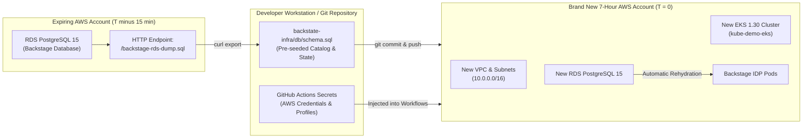

# Disaster Recovery & State Continuity Playbook

This document defines the Disaster Recovery (DR) and continuous re-hydration protocols required to operate production-like workloads within 7-hour ephemeral AWS sandbox environments.

---

## 1. Objectives & Metrics

In an ephemeral cloud sandbox model, "disaster" is a guaranteed, scheduled event occurring every 7 hours when the cloud provider terminates the AWS account.

| Metric | Target | Realized | Mechanism |
|---|---|---|---|
| **Recovery Time Objective (RTO)** | < 30 minutes | **~18 minutes** | Fully automated GitHub Actions CI/CD workflows across 4 decoupled repositories. |
| **Recovery Point Objective (RPO)** | < 1 hour | **0 seconds (Code)**<br>**Periodic (DB)** | 100% Infrastructure-as-Code in Git; Backstage RDS SQL export endpoint. |

---

## 2. State & Persistence Architecture



---

## 3. Pre-Expiration Backup Protocol (Phase 0)

If the active AWS account contains newly registered Backstage catalog entities, custom templates, or documentation that you wish to preserve into the next account rotation:

1. **Download Live SQL Dump:**
   ```bash
   curl -u admin:Backstage@2026 \
     -o /home/ciro/backstate-infra/db/schema.sql \
     http://backstage.<lab-id>.realhandsonlabs.net/backstage-rds-dump.sql
   ```

2. **Commit Updated Schema (Optional):**
   ```bash
   cd /home/ciro/backstate-infra
   git add db/schema.sql
   git commit -m "chore(backup): snapshot Backstage database schema before sandbox rotation"
   git push origin main
   ```

---

## 4. Zero-to-Production Re-Hydration Sequence

When your new AWS sandbox account credentials become available:

### Step 1: Export Local Environment Variables
```bash
export AWS_ACCESS_KEY_ID="ASIA..."
export AWS_SECRET_ACCESS_KEY="..."
export AWS_SESSION_TOKEN="..."       # If session tokens are used by the sandbox
export AWS_REGION="us-east-1"
```

### Step 2: Propagate Credentials to GitHub Actions Secrets
Update both the `cirobessa` and `cirodasilvaj` repository accounts:

```bash
# 1. Update EKS Cluster Repository (cirobessa)
gh auth switch -u cirobessa
gh secret set AWS_ACCESS_KEY_ID -b "$AWS_ACCESS_KEY_ID" -R cirobessa/kube-demo-2026
gh secret set AWS_SECRET_ACCESS_KEY -b "$AWS_SECRET_ACCESS_KEY" -R cirobessa/kube-demo-2026
gh secret set AWS_REGION -b "$AWS_REGION" -R cirobessa/kube-demo-2026

# 2. Update Platform and Identity Repositories (cirodasilvaj)
gh auth switch -u cirodasilvaj
for repo in cirodasilvaj/backstage-infra cirodasilvaj/samba-ad-keycloak cirodasilvaj/apps-demo-2026; do
  gh secret set AWS_ACCESS_KEY_ID -b "$AWS_ACCESS_KEY_ID" -R "$repo"
  gh secret set AWS_SECRET_ACCESS_KEY -b "$AWS_SECRET_ACCESS_KEY" -R "$repo"
  gh secret set AWS_REGION -b "$AWS_REGION" -R "$repo"
done
```

### Step 3: Trigger Tier 1 — Base Infrastructure & EKS Cluster
```bash
gh auth switch -u cirobessa
gh workflow run eks.yml -R cirobessa/kube-demo-2026 -f action=apply
```
*Duration: ~12 minutes.* Automatically creates the VPC, public/private subnets, NAT Gateway, EKS 1.30 cluster, worker nodes, and installs the Prometheus Helm chart.

### Step 4: Configure Local `kubectl`
```bash
aws eks update-kubeconfig --name kube-demo-eks --region us-east-1
kubectl get nodes
```

### Step 5: Trigger Tier 2 — DevEx Platform, RDS, ArgoCD & Backstage
```bash
gh auth switch -u cirodasilvaj
gh workflow run terraform.yml -R cirodasilvaj/backstage-infra -f action=apply
```
*Duration: ~5 minutes.* Creates the RDS PostgreSQL instance, imports `db/schema.sql`, deploys Backstage, ArgoCD, SonarQube, Grafana, and delegates Route 53 CNAMEs.

### Step 6: Trigger Tier 3 — Enterprise IAM & Samba 4 Multi-DC
```bash
gh auth switch -u cirodasilvaj
gh workflow run deploy.yml -R cirodasilvaj/samba-ad-keycloak -f action=apply
```
*Duration: ~4 minutes.* Launches the dual Active Directory EC2 instances directly inside the EKS VPC private subnets, configures FreeRADIUS MFA, Keycloak SSO, and Route 53 LDAP records.

### Step 7: Trigger Tier 4 — Polyglot Microservices & Quality Gate
```bash
gh auth switch -u cirodasilvaj
gh workflow run build.yml -R cirodasilvaj/apps-demo-2026
```
*Duration: ~3 minutes.* Builds the Python and .NET container images, runs SonarQube static analysis, deploys to Kubernetes, and registers Route 53 endpoints.

---

## 5. Controlled Teardown (Prior to Intentional Account Reset)

If you plan to tear down an environment cleanly before account termination:

```bash
# 1. Destroy Apps & IAM
gh workflow run deploy.yml -R cirodasilvaj/samba-ad-keycloak -f action=destroy

# 2. Destroy Platform & RDS
gh workflow run terraform.yml -R cirodasilvaj/backstage-infra -f action=destroy

# 3. Destroy Base EKS & VPC
gh workflow run eks.yml -R cirobessa/kube-demo-2026 -f action=destroy
```

> [!TIP]
> Executing `destroy` on Kubernetes Ingress / LoadBalancer services prior to destroying the VPC guarantees that AWS Elastic Load Balancers and security group dependencies are detached cleanly, preventing orphaned ENIs from blocking VPC deletion.
