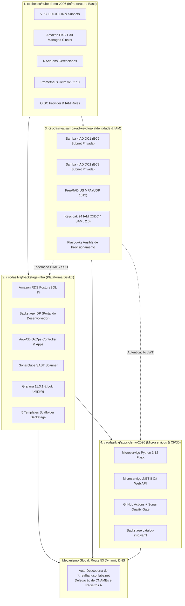

# Guia Completo de Instalações, Componentes e Configurações nos 4 Repositórios

Este documento consolida e detalha **todas as instalações, componentes, módulos Terraform, manifests Kubernetes, add-ons, configurações de observabilidade, serviços de identidade e integrações de CI/CD** implementados ao longo dos 4 repositórios que compõem a arquitetura da plataforma corporativa na AWS.

---

## 1. Visão Geral do Ecossistema Desacoplado

A arquitetura foi estruturada em 4 repositórios independentes para isolar zonas de falha e permitir reprovisionamento em menos de 20 minutos dentro de contas efêmeras da AWS com duração de 7 horas:

---

## 2. Repositório 1: `cirobessa/kube-demo-2026` (Infraestrutura Base)

**Objetivo:** Prover a base de rede, cluster Kubernetes gerenciado, add-ons essenciais e observabilidade inicial do cluster.

### 2.1 Rede VPC e Subnets (`eks/vpc.tf`)
- **VPC CIDR:** `10.0.0.0/16` com suporte a DNS e Hostnames habilitados (`enable_dns_support = true`, `enable_dns_hostnames = true`).
- **Subnets Públicas:**
  - `10.0.0.0/24` (AZ `us-east-1a`) — Hospeda o NAT Gateway e Load Balancers externos. Tag: `kubernetes.io/role/elb = 1`.
  - `10.0.1.0/24` (AZ `us-east-1b`) — Redundância multi-AZ para ELBs públicos. Tag: `kubernetes.io/role/elb = 1`.
- **Subnets Privadas:**
  - `10.0.10.0/24` (AZ `us-east-1a`) — Hospeda nós trabalhadores do EKS, RDS e EC2s do Active Directory. Tag: `kubernetes.io/role/internal-elb = 1`.
  - `10.0.11.0/24` (AZ `us-east-1b`) — Subnet privada secundária para alta disponibilidade. Tag: `kubernetes.io/role/internal-elb = 1`.
- **Roteamento e Conectividade:**
  - 1 Internet Gateway (`aws_internet_gateway.this`) para saída da subnet pública.
  - 1 NAT Gateway (`aws_nat_gateway.this`) com Elastic IP dedicado (`aws_eip.nat`), roteando a saída segura de toda a subnet privada para a internet sem expor portas públicas.

### 2.2 Cluster Gerenciado EKS 1.30 (`eks/main.tf`)
- **Versão do Kubernetes:** `1.30`.
- **Endpoints da API:** Acesso público e privado habilitado.
- **Managed Node Group:**
  - Capacidade: 2 nós fixos (`min = 2`, `desired = 2`, `max = 2`).
  - Tipo de Instância: `t3.medium` (2 vCPUs, 4 GiB RAM), otimizado para equilíbrio custo/benefício no laboratório.
  - Alocação: Exclusivamente em subnets privadas.

### 2.3 Add-ons Gerenciados do EKS (`eks/addons.tf`)
Foram instalados e reconciliados 6 add-ons essenciais do ecossistema EKS:
1. **`vpc-cni`:** Driver de rede nativo da AWS que aloca IPs secundários de ENIs diretamente para cada Pod.
2. **`coredns`:** Resolução interna de nomes de serviço dentro do cluster.
3. **`kube-proxy`:** Roteamento de pacotes iptables/IPVS para serviços Kubernetes.
4. **`eks-pod-identity-agent`:** Novo agente AWS para troca de credenciais de Pod Identity.
5. **`metrics-server`:** Emissão de métricas em tempo real para `kubectl top` e HPA (Horizontal Pod Autoscaler).
6. **`aws-mountpoint-s3-csi-driver`:** Driver CSI para montagem de buckets S3 diretamente como volumes em Pods.

### 2.4 IAM OIDC Provider e Roles IRSA (`eks/irsa.tf`)
- Configuração do **AWS OpenID Connect (OIDC)** associado ao cluster EKS.
- **Role `fluentd-role`:** AssumeRole com Web Identity para o ServiceAccount `system:serviceaccount:logging:fluentd`, permitindo envio de logs para CloudWatch/S3.
- **Role `s3_csi`:** AssumeRole com Web Identity vinculado ao add-on `aws-mountpoint-s3-csi-driver`.

### 2.5 Stack de Monitoramento Prometheus (`eks/prometheus.tf`)
- **Helm Chart:** `prometheus-community/prometheus` versão `25.27.0`.
- **Namespace:** `monitoring`.
- **Configurações Especiais:**
  - `server.persistentVolume.enabled = false` e `alertmanager.persistentVolume.enabled = false` (adequado para o ciclo efêmero de 7 horas).
  - Execução não-bloqueante no Terraform (`wait = false`) para evitar timeouts de pipeline.
  - URL in-cluster: `http://prometheus-server.monitoring.svc.cluster.local`.

### 2.6 Pipeline CI/CD no GitHub Actions (`.github/workflows/`)
- **`_terraform.yml`:** Workflow reutilizável com Backend remoto no S3, trava nativa (DynamoDB / S3 native lock), validação (`terraform fmt`, `terraform validate`), `plan`, `apply` e `destroy`.
- **`eks.yml`:** Disparador via `workflow_dispatch` com parâmetro de ação (`apply` ou `destroy`).

---

## 3. Repositório 2: `cirodasilvaj/backstage-infra` (Plataforma DevEx)

**Objetivo:** Prover o portal interno de desenvolvedores (IDP), entrega contínua com GitOps, análise estática de segurança e dashboards de observabilidade.

### 3.1 Banco de Dados Relacional (`terraform/rds.tf` e `db/`)
- **Amazon RDS PostgreSQL 15:** Instância de banco gerenciado provisionada nas subnets privadas do EKS.
- **Pre-seeding de Esquema (`db/schema.sql`):** Inicialização automática das tabelas do catálogo do Backstage, entidades, usuários e plugins.
- **Endpoint de Backup / DR:** Servidor expõe `/backstage-rds-dump.sql` autenticado para exportação rápida do dump SQL antes do encerramento da conta.

### 3.2 Backstage Developer Portal (`k8s-manifests/backstage/`)
- **Deployment & Service:** Aplicação Backstage em Node.js com LoadBalancer público.
- **`configmap-app-config.yaml`:** Configuração completa contendo:
  - Integração com o RDS PostgreSQL 15.
  - **Plugin de Kubernetes:** Leitura de pods, deployments e réplicas no cluster EKS via RBAC dedicado (`rbac.yaml`).
  - **Plugin do ArgoCD:** Visualização de sincronismo e saúde das aplicações GitOps.
  - **Plugin do SonarQube:** Leitura de bugs, vulnerabilidades, code smells e cobertura de testes.
  - **Plugin do Grafana / Prometheus:** Visualização de métricas e dashboards embebidos.
  - Registro automático dos locais dos componentes `python-app` e `dotnet-csharp-app`.

### 3.3 Motor GitOps ArgoCD (`k8s-manifests/argo/`)
- Instalação do ArgoCD com CRDs e controller de reconciliação de estado desejado.
- **Aplicações ArgoCD Declarativas:**
  - `application-backstage.yaml`: Gerencia o ciclo de vida do Backstage via GitOps.
  - `application-grafana.yaml`: Gerencia os deployments do Grafana.
  - `application-sonarqube.yaml`: Gerencia o servidor SonarQube.
  - `argo-app-apps-demo.yaml`: Gerencia os microserviços Python e .NET.
- **Métricas Prometheus:** Service dedicado expondo métricas do ArgoCD Controller para coleta do Prometheus sem disparar hooks com conflito de versão.

### 3.4 Servidor de Análise de Código SonarQube (`k8s-manifests/sonarqube/`)
- Deployment do servidor SonarQube Community Edition no namespace `sonarqube`.
- Service do tipo LoadBalancer para acesso dos desenvolvedores e dos runners do GitHub Actions.
- Banco de dados embutido/conectado para armazenamento de relatórios SAST e Quality Gates.

### 3.5 Grafana 11.3.1 e Loki (`k8s-manifests/grafana/`)
- **Versão Unificada:** Grafana `11.3.1`.
- **Dashboards Auto-provisionados (`configmap-provisioning.yaml`):**
  - Dashboard de Visão Geral do Cluster EKS (CPU, Memória, I/O, Rede).
  - Dashboard de Métricas de Pods e Aplicações.
  - Dashboard integrado ao Loki para análise de logs.
- **Loki (`loki.yaml`):** Agregador central de logs recebendo fluxos do daemonset Fluentd.

### 3.6 Esqueletos de Software Backstage (Scaffolder Templates em `templates/`)
Foram estruturados 5 templates com suporte completo a Nunjucks, `catalog-info.yaml`, pipelines de CI (`ci.yml`) e seletor de repositório (`RepoUrlPicker`):
1. **Python Flask** (com Prometheus `/metrics` e SonarQube).
2. **.NET 8 C#** (com Health checks `/healthz` e OpenTelemetry).
3. **JVM Spring Boot** (com Actuator e micrometer).
4. **Node.js Express** (com prom-client e Winston logger).
5. **Go Gin / Fiber** (com probe e profiling).

### 3.7 DNS Dinâmico Route 53 (`terraform/dns.tf` & `scripts/sync-cluster-dns.sh`)
- Consulta dinâmica via `data "aws_route53_zone" "lab"`.
- Delegação automática de registros CNAME:
  - `backstage.<lab-id>.realhandsonlabs.net`
  - `argocd.<lab-id>.realhandsonlabs.net`
  - `sonarqube.<lab-id>.realhandsonlabs.net`
  - `grafana.<lab-id>.realhandsonlabs.net`

---

## 4. Repositório 3: `cirodasilvaj/samba-ad-keycloak` (Identidade Corporativa)

**Objetivo:** Prover o Active Directory corporativo, autenticação multifator (MFA) e Single Sign-On (SSO) centralizado para a plataforma.

### 4.1 Instâncias EC2 no VPC Privado do EKS (`terraform/main.tf`)
Para garantir segurança máxima e latência quase zero com o EKS, as instâncias EC2 foram criadas **diretamente nas subnets privadas da VPC do cluster**:
- **`samba_dc1`:** Primeiro Controlador de Domínio Active Directory (IP privado `10.0.10.50`).
- **`samba_dc2`:** Segundo Controlador de Domínio para replicação redundante (IP privado `10.0.10.51`).
- **`keycloak`:** Servidor Keycloak 24 IAM conectado via Security Groups dedicados.

### 4.2 Samba 4 Active Directory Multi-DC
- Provisionamento de domínio Active Directory (`lab.internal`).
- **Replicação Ativa DRS:** Replicação bidirecional de diretório, usuários, grupos e políticas entre `dc1` e `dc2`.
- **Desativação do DNS Embutido:** O Samba foi configurado com `--dns-backend=NONE`, eliminando qualquer disputa de porta 53 com o AWS Route 53 e o CoreDNS do EKS.
- Serviço LDAP na porta TCP `389`.

### 4.3 FreeRADIUS MFA
- Servidor RADIUS configurado na porta UDP `1812`.
- Validação secundária por fatores baseados em tempo (TOTP).

### 4.4 Keycloak 24 IAM Gateway
- Servidor Keycloak 24 com provisionamento via playbooks Ansible (`ansible/`).
- **User Federation:** Sincronização direta de contas e grupos com o Active Directory via LDAP.
- **Protocolos Emitidos:**
  - OpenID Connect (OIDC) com tokens JWT para login de engenheiros no Backstage e no ArgoCD.
  - Suporte a federação SAML 2.0.

### 4.5 DNS Dinâmico Route 53 (`terraform/dns.tf`)
- Registro A Round-Robin para LDAP balanceado entre DC1 e DC2:
  - `ad.<lab-id>.realhandsonlabs.net` -> `10.0.10.50`, `10.0.10.51`
- Registro CNAME para Keycloak:
  - `sso.<lab-id>.realhandsonlabs.net` / `keycloak.<lab-id>.realhandsonlabs.net`
- Registro A para MFA:
  - `radius.<lab-id>.realhandsonlabs.net`

---

## 5. Repositório 4: `cirodasilvaj/apps-demo-2026` (Microserviços & CI/CD)

**Objetivo:** Implementar aplicações de demonstração em múltiplas linguagens com telemetria nativa, validação por Quality Gate de segurança e integração ao catálogo do Backstage.

### 5.1 Microserviço Python 3.12 Flask (`python-app/`)
- **Funcionalidades:** API REST que exibe linguagem, versão, IP do cliente e hostname do pod.
- **Métricas Prometheus:** Exposição de métricas na rota `/metrics` via biblioteca `prometheus_client`.
- **Logs Estruturados:** Saída em JSON para captura automática via Fluentd e indexação no Loki.
- **Testes Unitários:** Suíte de testes com `pytest` e cobertura de código com `pytest-cov`.
- **Catalog Backstage:** Arquivo [`catalog-info.yaml`](https://github.com/cirodasilvaj/apps-demo-2026/blob/main/python-app/catalog-info.yaml) com metadados do componente, sistema `enterprise-platform`, links do SonarQube e dashboards do Grafana.

### 5.2 Microserviço .NET 8 C# Web API (`dotnet-csharp-app/`)
- **Funcionalidades:** ASP.NET Core 8 Web API corporativa.
- **Probes de Saúde:** Rotas `/healthz` (liveness) e `/ready` (readiness).
- **Instrumentação:** Suporte a métricas e tracing via OpenTelemetry.
- **Testes:** Suíte de testes unitários com xUnit gerando relatórios de cobertura XPlat.
- **Catalog Backstage:** Arquivo [`catalog-info.yaml`](https://github.com/cirodasilvaj/apps-demo-2026/blob/main/dotnet-csharp-app/catalog-info.yaml) dedicado para o ecossistema .NET.

### 5.3 Pipeline de CI/CD e SonarQube Quality Gate (`.github/workflows/build.yml`)
1. **Checkout de código** com profundidade total para análise Git no SonarQube.
2. **Execução de testes** unitários do Python 3.12 e .NET 8 com exportação de cobertura em XML.
3. **SonarQube SAST Scanner:** Análise estática de vulnerabilidades e code smells.
4. **Quality Gate Check:** Trava de aprovação (pipeline falha caso o Quality Gate do SonarQube não passe).
5. **Build & Deploy:** Empacotamento Docker com etiquetas OpenContainers para vinculação com o repositório no GitHub Container Registry (GHCR) e aplicação dos manifests Kubernetes no cluster EKS.

### 5.4 DNS Dinâmico Route 53
- `http://python.<lab-id>.realhandsonlabs.net`
- `http://dotnet.<lab-id>.realhandsonlabs.net`

---

## 6. Matriz Unificada de Componentes e Portas

| Componente | Repositório | Tipo / Camada | Porta Interna | Endpoint Dinâmico Route 53 |
|---|---|---|---|---|
| **EKS Control Plane** | `kube-demo-2026` | Kubernetes 1.30 API | TCP 443 | `https://<EKS_CLUSTER_ENDPOINT>` |
| **Prometheus** | `kube-demo-2026` | Helm v25.27.0 | TCP 9090 | `http://prometheus-server.monitoring.svc.cluster.local` |
| **Backstage IDP** | `backstage-infra` | Node.js Developer Portal | TCP 7007 | `http://backstage.<lab-id>.realhandsonlabs.net` |
| **ArgoCD GitOps** | `backstage-infra` | Controller / Web UI | TCP 80/443 | `http://argocd.<lab-id>.realhandsonlabs.net` |
| **SonarQube** | `backstage-infra` | SAST Security Scanner | TCP 9000 | `http://sonarqube.<lab-id>.realhandsonlabs.net` |
| **Grafana 11.3.1** | `backstage-infra` | Telemetria / Dashboards | TCP 3000 | `http://grafana.<lab-id>.realhandsonlabs.net` |
| **Loki** | `backstage-infra` | Agregador de Logs | TCP 3100 | `http://loki.monitoring.svc.cluster.local:3100` |
| **RDS PostgreSQL 15** | `backstage-infra` | Banco de Dados Relacional | TCP 5432 | `postgres.<lab-id>.internal:5432` |
| **Samba 4 AD DC1** | `samba-ad-keycloak` | Active Directory Primary | TCP 389 | `ldap://ad.<lab-id>.realhandsonlabs.net:389` |
| **Samba 4 AD DC2** | `samba-ad-keycloak` | Active Directory Replicado| TCP 389 | `ldap://ad.<lab-id>.realhandsonlabs.net:389` |
| **FreeRADIUS MFA** | `samba-ad-keycloak` | Autenticação Multifator | UDP 1812 | `radius.<lab-id>.realhandsonlabs.net:1812` |
| **Keycloak 24 IAM** | `samba-ad-keycloak` | SSO (OIDC / SAML 2.0) | TCP 8080 | `http://sso.<lab-id>.realhandsonlabs.net` |
| **Python Flask App** | `apps-demo-2026` | Microserviço REST | TCP 5000 | `http://python.<lab-id>.realhandsonlabs.net` |
| **.NET 8 C# App** | `apps-demo-2026` | Microserviço REST | TCP 8080 | `http://dotnet.<lab-id>.realhandsonlabs.net` |

---

## 7. Referências e Navegação Rápida

- 🚀 **Manual de Execução Passo a Passo:** [`DEPLOY-ORDER-RUNBOOK.md`](file:///home/ciro/kube-demo-2026/DEPLOY-ORDER-RUNBOOK.md)
- 📐 **Blueprint de Arquitetura Detalhado:** [`docs/ARCHITECTURE.md`](file:///home/ciro/kube-demo-2026/docs/ARCHITECTURE.md)
- 🌐 **Mecanismo Route 53:** [`docs/ROUTE53-DYNAMIC-DNS.md`](file:///home/ciro/kube-demo-2026/docs/ROUTE53-DYNAMIC-DNS.md)
- 🛡️ **Disaster Recovery e Persistência:** [`docs/DISASTER-RECOVERY.md`](file:///home/ciro/kube-demo-2026/docs/DISASTER-RECOVERY.md)
- 📊 **Observabilidade e Métricas:** [`docs/OBSERVABILITY-AND-MONITORING.md`](file:///home/ciro/kube-demo-2026/docs/OBSERVABILITY-AND-MONITORING.md)
- 🔑 **IAM e Active Directory:** [`docs/IAM-AND-IDENTITY.md`](file:///home/ciro/kube-demo-2026/docs/IAM-AND-IDENTITY.md)
- ⚙️ **Microserviços & CI/CD:** [`docs/MICROSERVICES-AND-CICD.md`](file:///home/ciro/kube-demo-2026/docs/MICROSERVICES-AND-CICD.md)
- 📑 **Apresentação em Slides:** [`docs/PRESENTATION.md`](file:///home/ciro/kube-demo-2026/docs/PRESENTATION.md) e arquivo binário [`docs/kube-demo-2026-architecture.pptx`](file:///home/ciro/kube-demo-2026/docs/kube-demo-2026-architecture.pptx)
