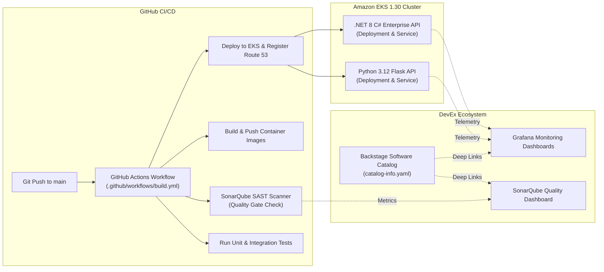

# Polyglot Microservices & CI/CD Pipeline Blueprint

This document details the microservices architecture, automated CI/CD pipelines, SonarQube quality gates, and Backstage catalog integration implemented in [`cirodasilvaj/apps-demo-2026`](https://github.com/cirodasilvaj/apps-demo-2026).

---

## 1. Application Ecosystem Overview



---

## 2. Microservice Implementations

### 2.1 Python 3.12 Flask Microservice (`python-app`)
- **Language & Runtime:** Python 3.12 running inside minimal Alpine Linux container.
- **RESTful Architecture:** Modular Flask application structure with blueprints and JSON schemas.
- **Observability:**
  - `prometheus_client` exporter exposes application metrics at `/metrics`.
  - Structured JSON logging facilitates ingestion by Fluentd and Loki.
- **Route 53 Live Endpoint:** `http://python.<lab-id>.realhandsonlabs.net`

### 2.2 .NET 8 C# Enterprise Web API (`dotnet-csharp-app`)
- **Framework & Runtime:** ASP.NET Core 8 Web API running on Linux container.
- **Resilience & Probes:**
  - Liveness probe: `/healthz`
  - Readiness probe: `/ready`
- **Telemetry:** Built-in OpenTelemetry instrumentation and request tracing.
- **Route 53 Live Endpoint:** `http://dotnet.<lab-id>.realhandsonlabs.net`

---

## 3. Automated CI/CD & SonarQube Quality Gate

The GitHub Actions workflow (`.github/workflows/build.yml`) implements strict quality enforcement:

```yaml
name: Build, Scan & Deploy Microservices

on:
  push:
    branches: [ main ]
  workflow_dispatch:

jobs:
  test-and-scan:
    runs-on: ubuntu-latest
    steps:
      - name: Checkout Code
        uses: actions/checkout@v4
        with:
          fetch-depth: 0

      - name: Set up Python 3.12
        uses: actions/setup-python@v5
        with:
          python-version: '3.12'

      - name: Run Python Unit Tests with Coverage
        run: |
          cd python-app
          pip install -r requirements.txt pytest pytest-cov
          pytest --cov=. --cov-report=xml

      - name: Set up .NET 8
        uses: actions/setup-dotnet@v4
        with:
          dotnet-version: '8.0.x'

      - name: Run .NET Unit Tests
        run: |
          dotnet test dotnet-csharp-app/*.csproj --collect:"XPlat Code Coverage"

      - name: SonarQube SAST Scanner
        uses: SonarSource/sonarqube-scan-action@v2
        env:
          SONAR_TOKEN: ${{ secrets.SONAR_TOKEN }}
          SONAR_HOST_URL: ${{ secrets.SONAR_HOST_URL }}

      - name: SonarQube Quality Gate Check
        uses: SonarSource/sonarqube-quality-gate-action@v1
        timeout-minutes: 5
        env:
          SONAR_TOKEN: ${{ secrets.SONAR_TOKEN }}
```

---

## 4. Backstage Software Catalog Integration

Both microservices are cataloged in Backstage using standardized `catalog-info.yaml` manifests:

```yaml
apiVersion: backstage.io/v1alpha1
kind: Component
metadata:
  name: python-app
  title: Python 3.12 Flask Demo Microservice
  description: High-performance demo REST API with Prometheus exporter and JSON logging
  tags:
    - python
    - flask
    - microservice
  annotations:
    github.com/project-slug: cirodasilvaj/apps-demo-2026
    backstage.io/techdocs-ref: dir:.
    sonarqube.org/project-key: apps-demo-2026:python-app
    prometheus.io/rule: python_app_http_requests_total
    grafana/dashboard-selector: "app=python-app"
spec:
  type: service
  lifecycle: production
  owner: group:engineering
  system: enterprise-platform
  providesApis:
    - python-api
```

---

## 5. Deployment Verification

After triggering the deployment workflow, verify the microservices via CLI:

```bash
# 1. Check Pods in Kubernetes
kubectl get pods -l app=python-app
kubectl get pods -l app=dotnet-csharp-app

# 2. Check Services and LoadBalancers
kubectl get svc python-app-service dotnet-csharp-app-service

# 3. Test HTTP Endpoints via Dynamic Route 53
curl -s http://python.<lab-id>.realhandsonlabs.net/metrics | head -n 10
curl -s http://dotnet.<lab-id>.realhandsonlabs.net/healthz
```
