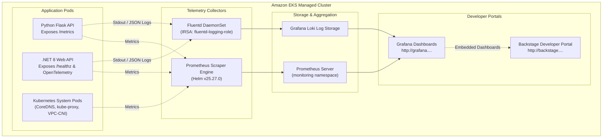
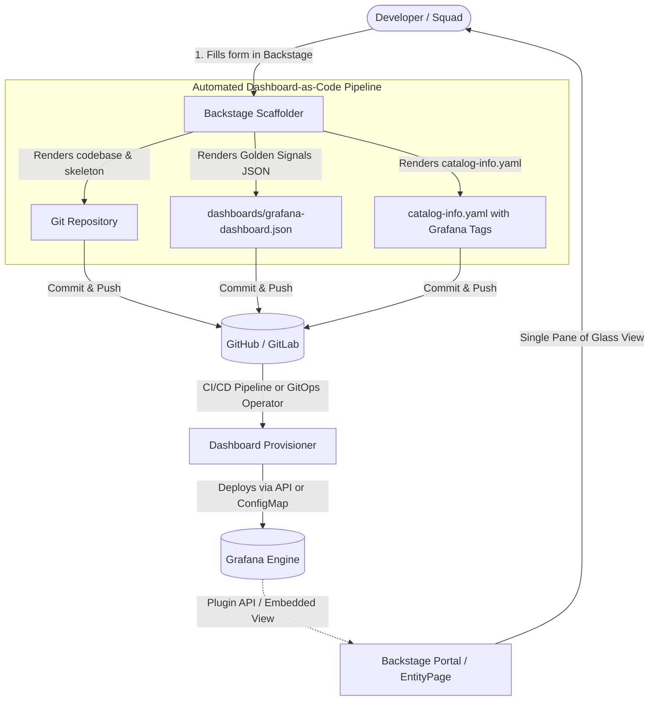

# Observability & Telemetry Architecture

This document outlines the observability, metrics collection, and logging architecture configured on the Amazon EKS cluster across all applications and platform services.

---

## 1. Observability Overview

The observability stack follows a three-pillar paradigm (Metrics, Logs, and Traces), tightly integrated with Backstage to provide software engineers with single-pane-of-glass insight into cluster health and application performance.



---

## 2. Metrics Architecture (Prometheus)

### 2.1 Deployment Configuration
As defined in [`eks/prometheus.tf`](file:///home/ciro/kube-demo-2026/eks/prometheus.tf), the Prometheus Community Helm chart is deployed directly during Tier 1 base infrastructure setup:

```hcl
resource "helm_release" "prometheus" {
  name            = "prometheus"
  repository      = "https://prometheus-community.github.io/helm-charts"
  chart           = "prometheus"
  namespace       = kubernetes_namespace.monitoring.metadata[0].name
  version         = "25.27.0"
  wait            = false
  cleanup_on_fail = true
  force_update    = true

  set {
    name  = "server.persistentVolume.enabled"
    value = "false"
  }
  set {
    name  = "alertmanager.persistentVolume.enabled"
    value = "false"
  }
}
```

### 2.2 Scrape Targets
- **Node Exporter:** Captures host-level CPU utilization, memory pressure, disk I/O, and network throughput across the `t3.medium` worker nodes.
- **cAdvisor:** Ingests container-level CPU/memory consumption, throttle counts, and restart loops.
- **kube-state-metrics:** Emits Kubernetes object statuses (Deployments, Pod phases, ReplicaSets, HPA states).
- **Application Endpoints:**
  - Python Flask microservice: Exposes standard Python garbage collection, request duration histograms, and endpoint HTTP status counters at `/metrics`.
  - .NET 8 Web API: Exposes runtime thread pool statistics, request latencies, and health probe states.

---

## 3. Visualization & Dashboards (Grafana)

### 3.1 Endpoint & Authentication
- **Dynamic Route 53 Endpoint:** `https://grafana.<lab-id>.realhandsonlabs.net` (ou fallback `http://...`)
- **Datasource:** Configured with Prometheus as default datasource pointing to:
  ```
  http://prometheus-server.monitoring.svc.cluster.local:80
  ```
- **Security & Credentials:** In accordance with corporate security governance, no plain-text passwords or API tokens are stored in documentation. All Grafana administrative credentials and API keys are stored in the unified AWS SSM Parameter Store:
  - **Parameter Name:** `/kube-demo-2026/platform/credentials`
  - **Parameter ARN:** `arn:aws:ssm:us-east-1:<AWS_ACCOUNT_ID>:parameter/kube-demo-2026/platform/credentials`
  - **Path inside JSON:** `.credentials.grafana.password` / `.credentials.grafana.url`

### 3.2 Pre-Loaded Dashboards
1. **Cluster Health & Node Metrics:** Real-time visibility into CPU, memory, and disk utilization across worker nodes.
2. **Kubernetes Pod Compute:** Per-namespace pod CPU/memory limits vs actual consumption.
3. **Application SLI/SLA Dashboards:** Visualizing 99th percentile response latencies, request rates (RPS), and error budgets (5xx HTTP responses).

---

## 4. Log Aggregation & IRSA (Fluentd & Loki)

### 4.1 IAM Role for Service Accounts (IRSA)
Fluentd runs as a Kubernetes DaemonSet. To avoid hardcoded AWS access keys, [`eks/irsa.tf`](file:///home/ciro/kube-demo-2026/eks/irsa.tf) configures an IAM role bound to the Fluentd service account:

```hcl
resource "aws_iam_role" "fluentd" {
  name = "${var.cluster_name}-fluentd-role"
  assume_role_policy = jsonencode({
    Version = "2012-10-17"
    Statement = [{
      Action = "sts:AssumeRoleWithWebIdentity"
      Effect = "Allow"
      Principal = {
        Federated = aws_iam_openid_connect_provider.eks.arn
      }
      Condition = {
        StringEquals = {
          "${replace(aws_iam_openid_connect_provider.eks.url, "https://", "")}:sub" : "system:serviceaccount:logging:fluentd"
        }
      }
    }]
  })
}
```

### 4.2 Structured Application Logging
Applications in `apps-demo-2026` output logs directly to `stdout` in structured JSON format:
```json
{
  "timestamp": "2026-11-01T10:30:00Z",
  "level": "INFO",
  "service": "python-app",
  "endpoint": "/api/v1/resource",
  "status_code": 200,
  "response_time_ms": 14.2
}
```
Fluentd parses this structured format, enriching entries with Kubernetes pod names, namespaces, and node tags before routing to Loki.

---

## 5. Observability Strategy: Minimizing Dashboards (Backstage + Grafana Dashboard-as-Code)

### 5.1 The Architectural Paradigm: "Single Pane of Glass" vs. Dashboard Sprawl
In enterprise engineering organizations, uncoordinated creation of monitoring panels leads to severe **dashboard sprawl**—hundreds of fragmented, stale dashboards with overlapping PromQL queries that generate alert fatigue and operational overhead.

The platform enforces a modern DevEx standard:
- **Backstage as the Single Pane of Glass (Daily Developer Experience):**  
  Developers access the service entry in the Backstage Software Catalog. On a single screen, they view Git commits, TechDocs, Kubernetes Pod lifecycle, and an embedded **Golden Signals Card** (Throughput/RPS, 5xx Error Rate, p99 Latency, and real-time Loki error logs). Developers do not need to hunt through Grafana folders or configure PromQL queries for day-to-day operations.
- **Grafana as the Underlying Rendering Engine & Deep Dive Tool:**  
  Grafana maintains raw telemetry storage and visualization rendering. When high-severity incidents or performance anomalies require granular root-cause analysis, developers click **"Open in Grafana"** directly from Backstage to execute ad-hoc PromQL/LogQL queries, timeline zooming, and multi-dimensional metric correlation.



---

### 5.2 Automated Dashboard-as-Code via Backstage Software Templates

To prevent manual dashboard creation and enforce uniform Golden Signals, every microservice generated via the Backstage Scaffolder automatically provisions its own dashboard.

#### 1. Scaffolder Template Definition (`template.yaml`)
```yaml
apiVersion: scaffolder.backstage.io/v1beta3
kind: Template
metadata:
  name: microservice-observability-template
  title: Microservice with Automated Grafana Dashboard
  description: Scaffolds microservice repository with automatic Grafana dashboard provisioning
spec:
  owner: platform-team
  type: service
  parameters:
    - title: Service Details
      required:
        - component_id
        - owner
      properties:
        component_id:
          title: Service Name
          type: string
          description: Unique kebab-case service identifier (e.g., payment-service)
        owner:
          title: Owning Team
          type: string
          description: Backstage group entity (e.g., squad-checkout)
  steps:
    - id: fetch-base
      name: Render Base Code & Observability Skeleton
      action: fetch:template
      input:
        url: ./skeleton
        values:
          component_id: ${{ parameters.component_id }}
          owner: ${{ parameters.owner }}

    - id: publish-repo
      name: Create GitHub Repository
      action: publish:github
      input:
        repoUrl: github.com?repo=${{ parameters.component_id }}&owner=cirodasilvaj
        defaultBranch: main

    - id: register-catalog
      name: Register Component in Backstage
      action: catalog:register
      input:
        repoContentsUrl: ${{ steps['publish-repo'].output.repoContentsUrl }}
        catalogInfoPath: '/catalog-info.yaml'
```

---

#### 2. Skeleton Dashboard Definition (`skeleton/dashboards/grafana-dashboard.json`)
The templated dashboard renders queries dynamically bound to the service identifier:

```json
{
  "title": "${{ values.component_id }} - Operational Overview",
  "uid": "${{ values.component_id }}-dashboard",
  "tags": ["service:${{ values.component_id }}", "automated", "gold-signals"],
  "editable": false,
  "panels": [
    {
      "id": 1,
      "title": "Throughput / Request Rate (RPS)",
      "type": "timeseries",
      "gridPos": { "h": 8, "w": 12, "x": 0, "y": 0 },
      "targets": [
        {
          "expr": "sum(rate(http_requests_total{app=\"${{ values.component_id }}\"}[1m]))",
          "legendFormat": "RPS"
        }
      ]
    },
    {
      "id": 2,
      "title": "Error Rate (HTTP 5xx %)",
      "type": "timeseries",
      "gridPos": { "h": 8, "w": 12, "x": 12, "y": 0 },
      "targets": [
        {
          "expr": "sum(rate(http_requests_total{app=\"${{ values.component_id }}\",status=~\"5..\"}[1m])) / sum(rate(http_requests_total{app=\"${{ values.component_id }}\"}[1m])) * 100",
          "legendFormat": "5xx Error %"
        }
      ]
    },
    {
      "id": 3,
      "title": "Latency p99 (Milliseconds)",
      "type": "timeseries",
      "gridPos": { "h": 8, "w": 12, "x": 0, "y": 8 },
      "targets": [
        {
          "expr": "histogram_quantile(0.99, sum(rate(http_request_duration_seconds_bucket{app=\"${{ values.component_id }}\"}[1m])) by (le)) * 1000",
          "legendFormat": "p99 (ms)"
        }
      ]
    },
    {
      "id": 4,
      "title": "Real-time Error Logs (Loki)",
      "type": "logs",
      "gridPos": { "h": 8, "w": 12, "x": 12, "y": 8 },
      "targets": [
        {
          "expr": "{app=\"${{ values.component_id }}\"} |= \"error\"",
          "queryType": "range"
        }
      ]
    }
  ]
}
```

---

#### 3. Component Catalog Registration (`skeleton/catalog-info.yaml`)
```yaml
apiVersion: backstage.io/v1alpha1
kind: Component
metadata:
  name: ${{ values.component_id }}
  annotations:
    # Binds the auto-provisioned Grafana dashboard to the Backstage component view
    grafana/dashboard-selector: ${{ values.component_id }}
    grafana/tag-selector: 'service:${{ values.component_id }}'
    backstage.io/source-location: url:https://github.com/cirodasilvaj/${{ values.component_id }}
    backstage.io/techdocs-ref: dir:.
spec:
  type: service
  lifecycle: production
  owner: ${{ values.owner }}
```

---

### 5.3 Provisioning Automation Workflows

1. **Option A — CI/CD Pipeline Provisioning (GitHub Actions):**
   In the repository pipeline, an automated step uploads the rendered dashboard directly to the Grafana REST API:
   ```yaml
   - name: Provision Grafana Dashboard
     env:
       GRAFANA_URL: "https://grafana.realhandsonlabs.net"
       GRAFANA_TOKEN: ${{ secrets.GRAFANA_API_TOKEN }}
     run: |
       curl -X POST \
         -H "Content-Type: application/json" \
         -H "Authorization: Bearer ${GRAFANA_TOKEN}" \
         -d @dashboards/grafana-dashboard.json \
         "${GRAFANA_URL}/api/dashboards/db"
   ```

2. **Option B — GitOps Kubernetes ConfigMap (Grafana Sidecar / Operator):**
   The template generates a ConfigMap manifest tagged with the discovery label `grafana_dashboard: "1"`:
   ```yaml
   apiVersion: v1
   kind: ConfigMap
   metadata:
     name: ${{ values.component_id }}-dashboard
     namespace: monitoring
     labels:
       grafana_dashboard: "1"
   data:
     dashboard.json: |-
       # JSON payload
   ```
   The Grafana dashboard sidecar detects the new ConfigMap and reloads it dynamically.

---

### 5.4 Backstage Frontend Configuration (`EntityPage.tsx` & `app-config.yaml`)

- **`app-config.yaml`:**
  ```yaml
  grafana:
    domain: https://grafana.realhandsonlabs.net
    apiToken: ${GRAFANA_API_TOKEN}
  ```

- **`EntityPage.tsx`:**
  ```tsx
  import { EntityGrafanaDashboardsCard, isGrafanaAvailable } from '@k-phoen/backstage-plugin-grafana';

  // Overview summary card
  const overviewContent = (
    <Grid container spacing={3} alignItems="stretch">
      <EntitySwitch>
        <EntitySwitch.Case if={isGrafanaAvailable}>
          <Grid item md={6} xs={12}>
            <EntityGrafanaDashboardsCard />
          </Grid>
        </EntitySwitch.Case>
      </EntitySwitch>
    </Grid>
  );

  // Dedicated Grafana tab
  const serviceEntityPage = (
    <EntityLayout>
      <EntityLayout.Route path="/" title="Overview">
        {overviewContent}
      </EntityLayout.Route>
      <EntityLayout.Route path="/grafana" title="Grafana" if={isGrafanaAvailable}>
        <EntityGrafanaDashboardsCard />
      </EntityLayout.Route>
      <EntityLayout.Route path="/docs" title="Docs">
        <EntityTechdocsContent />
      </EntityLayout.Route>
    </EntityLayout>
  );
  ```

---

## 6. Secure Credentials Storage (AWS SSM Parameter Store)

In compliance with enterprise security requirements, all observability credentials, API tokens, and admin passwords are never committed in plaintext or printed into pipeline artifacts.

All platform credentials are consolidated into a **single AWS Systems Manager (SSM) Parameter Store resource**:

- **Parameter Name:** `/kube-demo-2026/platform/credentials`
- **Parameter ARN:** `arn:aws:ssm:us-east-1:<AWS_ACCOUNT_ID>:parameter/kube-demo-2026/platform/credentials`
- **Type:** `SecureString` (KMS Encrypted)

### CLI Command to Fetch Observability Credentials:
```bash
# Retrieve full JSON payload
aws ssm get-parameter \
  --name "/kube-demo-2026/platform/credentials" \
  --with-decryption \
  --query "Parameter.Value" \
  --output text | jq .

# Extract Grafana password specifically
aws ssm get-parameter \
  --name "/kube-demo-2026/platform/credentials" \
  --with-decryption \
  --query "Parameter.Value" \
  --output text | jq -r '.credentials.grafana.password'
```
