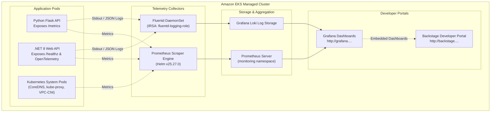

# Observability & Telemetry Architecture

This document outlines the observability, metrics collection, and logging architecture configured on the Amazon EKS cluster across all applications and platform services.

---

## 1. Observability Overview

The observability stack follows a three-pillar paradigm (Metrics, Logs, and Traces), tightly integrated with Backstage to provide software engineers with single-pane-of-glass insight into cluster health and application performance.



---

## 2. Metrics Architecture (Prometheus)

### 2.1 Deployment Configuration
As defined in [`eks/prometheus.tf`](file:///home/ciro/kube-demo-2026/eks/prometheus.tf), the Prometheus Community Helm chart is deployed directly during Tier 1 base infrastructure setup:

```hcl
resource "helm_release" "prometheus" {
  name            = "prometheus"
  repository      = "https://prometheus-community.github.io/helm-charts"
  chart           = "prometheus"
  namespace       = kubernetes_namespace.monitoring.metadata[0].name
  version         = "25.27.0"
  wait            = false
  cleanup_on_fail = true
  force_update    = true

  set {
    name  = "server.persistentVolume.enabled"
    value = "false"
  }
  set {
    name  = "alertmanager.persistentVolume.enabled"
    value = "false"
  }
}
```

### 2.2 Scrape Targets
- **Node Exporter:** Captures host-level CPU utilization, memory pressure, disk I/O, and network throughput across the `t3.medium` worker nodes.
- **cAdvisor:** Ingests container-level CPU/memory consumption, throttle counts, and restart loops.
- **kube-state-metrics:** Emits Kubernetes object statuses (Deployments, Pod phases, ReplicaSets, HPA states).
- **Application Endpoints:**
  - Python Flask microservice: Exposes standard Python garbage collection, request duration histograms, and endpoint HTTP status counters at `/metrics`.
  - .NET 8 Web API: Exposes runtime thread pool statistics, request latencies, and health probe states.

---

## 3. Visualization & Dashboards (Grafana)

### 3.1 Endpoint & Authentication
- **Dynamic Route 53 Endpoint:** `http://grafana.<lab-id>.realhandsonlabs.net`
- **Datasource:** Configured with Prometheus as default datasource pointing to:
  ```
  http://prometheus-server.monitoring.svc.cluster.local:80
  ```

### 3.2 Pre-Loaded Dashboards
1. **Cluster Health & Node Metrics:** Real-time visibility into CPU, memory, and disk utilization across worker nodes.
2. **Kubernetes Pod Compute:** Per-namespace pod CPU/memory limits vs actual consumption.
3. **Application SLI/SLA Dashboards:** Visualizing 99th percentile response latencies, request rates (RPS), and error budgets (5xx HTTP responses).

---

## 4. Log Aggregation & IRSA (Fluentd & Loki)

### 4.1 IAM Role for Service Accounts (IRSA)
Fluentd runs as a Kubernetes DaemonSet. To avoid hardcoded AWS access keys, [`eks/irsa.tf`](file:///home/ciro/kube-demo-2026/eks/irsa.tf) configures an IAM role bound to the Fluentd service account:

```hcl
resource "aws_iam_role" "fluentd" {
  name = "${var.cluster_name}-fluentd-role"
  assume_role_policy = jsonencode({
    Version = "2012-10-17"
    Statement = [{
      Action = "sts:AssumeRoleWithWebIdentity"
      Effect = "Allow"
      Principal = {
        Federated = aws_iam_openid_connect_provider.eks.arn
      }
      Condition = {
        StringEquals = {
          "${replace(aws_iam_openid_connect_provider.eks.url, "https://", "")}:sub" : "system:serviceaccount:logging:fluentd"
        }
      }
    }]
  })
}
```

### 4.2 Structured Application Logging
Applications in `apps-demo-2026` output logs directly to `stdout` in structured JSON format:
```json
{
  "timestamp": "2026-11-01T10:30:00Z",
  "level": "INFO",
  "service": "python-app",
  "endpoint": "/api/v1/resource",
  "status_code": 200,
  "response_time_ms": 14.2
}
```
Fluentd parses this structured format, enriching entries with Kubernetes pod names, namespaces, and node tags before routing to Loki.

---

## 5. Backstage Developer Portal Integration

Within Backstage, each application's [`catalog-info.yaml`](https://github.com/cirodasilvaj/apps-demo-2026/blob/main/python-app/catalog-info.yaml) declares direct links to its corresponding telemetry:

```yaml
apiVersion: backstage.io/v1alpha1
kind: Component
metadata:
  name: python-app
  annotations:
    prometheus.io/rule: python_app_http_requests_total
    grafana/dashboard-selector: "app=python-app"
    sonarqube.org/project-key: "apps-demo-2026:python-app"
```

Developers viewing a microservice in Backstage can navigate in a single click directly to its live Grafana dashboards, Prometheus metrics, and SonarQube quality gate scores.
