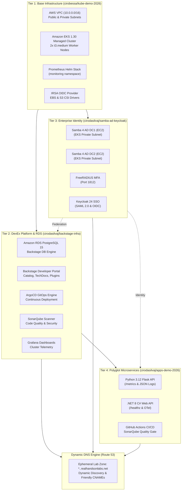

# Cloud Native Enterprise Platform Architecture (Presentation Deck)

> **File:** `docs/kube-demo-2026-architecture.pptx`  
> **Format:** Widescreen 16:9 • 12 Slides • Modern Dark Tech Theme  
> **Topic:** Ephemeral AWS Sandbox Automation, Decoupled 4-Tier Multi-Repo Architecture & Dynamic Route 53 DNS

---

## Slide 1: Title Slide

### Cloud Native Enterprise Platform on AWS EKS
**Ephemeral Sandbox Automation, Route 53 Dynamic DNS & 4-Tier Multi-Repo Decoupled Architecture**

- **Track:** AWS EKS • Cloud Native • DevOps Architecture 2026
- **Repositories Involved:**
  - Base Infrastructure: [`cirobessa/kube-demo-2026`](https://github.com/cirobessa/kube-demo-2026)
  - DevEx Platform & DB: [`cirodasilvaj/backstage-infra`](https://github.com/cirodasilvaj/backstage-infra)
  - IAM & Enterprise Identity: [`cirodasilvaj/samba-ad-keycloak`](https://github.com/cirodasilvaj/samba-ad-keycloak)
  - Microservices & CI/CD: [`cirodasilvaj/apps-demo-2026`](https://github.com/cirodasilvaj/apps-demo-2026)

---

## Slide 2: Context & Challenges — The 7-Hour Ephemeral AWS Sandbox Reality

```
+---------------------------------------------------------------------------------------+
|                              THE EPHEMERAL LAB LIFECYCLE                              |
|                                                                                       |
|  [ AWS Sandbox Starts ] ---> [ 7-Hour Lifespan ] ---> [ Hard Expiration / Purge ]     |
|             |                        |                              |                 |
|             v                        v                              v                 |
|   New Random Route 53 Zone    Deploy EKS, RDS, AD,        Zero Artifacts Left Behind  |
|   *.<lab-id>.realhandsonlabs  Apps & Ingresses            Instant Cloud Teardown      |
+---------------------------------------------------------------------------------------+
```

### Key Operational Challenges:
1. **Strict 7-Hour Lifespan:**
   - Every AWS account is destroyed automatically at the end of the lab session.
   - All state, VPCs, clusters, databases, and EC2 instances are terminated.
   - Zero-to-Production deployment must be completed in under 20 minutes without manual console clicks.
2. **Rotating Route 53 Domain Subsegments:**
   - Each spin-up receives a new public Route 53 zone matching `.<random-id>.realhandsonlabs.net`.
   - Hardcoded DNS records will fail immediately across rotations.
   - The architecture requires automated dynamic zone discovery and CNAME delegation.
3. **Decoupled Multi-Repo Orchestration:**
   - Distributed failure domains across 4 independent repositories and 2 GitHub accounts.
   - Requires deterministic execution order, automated credentials injection, and clean state locking.

---

## Slide 3: Global Architecture — Decoupled 4-Tier Orchestration



---

## Slide 4: Tier 1 — Core Infrastructure (Amazon EKS 1.30 & Cloud Foundation)

- **VPC & High-Availability Networking:**
  - CIDR Block: `10.0.0.0/16` with DNS hostnames and resolution enabled.
  - Public Subnets: `10.0.0.0/24` (AZ-a), `10.0.1.0/24` (AZ-b) tagged with `kubernetes.io/role/elb = 1`.
  - Private Subnets: `10.0.10.0/24` (AZ-a), `10.0.11.0/24` (AZ-b) tagged with `kubernetes.io/role/internal-elb = 1`.
  - Cost-effective NAT Gateway in public subnet `10.0.0.0/24` with dedicated Elastic IP.
- **EKS Managed Cluster:**
  - Kubernetes Version: **1.30**.
  - Node Group: Managed Node Group running 2× `t3.medium` instances inside private subnets.
  - Native Add-ons:
    - `vpc-cni`: Direct ENI-based pod networking.
    - `coredns` & `kube-proxy`: Core Kubernetes networking & service discovery.
    - `eks-pod-identity-agent`: Modern pod IAM identity management.
    - `metrics-server`: Cluster resource metrics for HPA.
    - `aws-mountpoint-s3-csi-driver`: Direct S3 bucket mounting for pods via IRSA.
- **Observability Foundation:**
  - Pre-deploys Prometheus Community Helm chart (v25.27.0) into the `monitoring` namespace.

---

## Slide 5: Tier 2 — Platform & DevEx (Backstage, ArgoCD, SonarQube & RDS)

- **Backstage Internal Developer Portal (IDP):**
  - Centralized single-pane-of-glass software catalog, TechDocs, and API portal.
  - Pre-integrated with ArgoCD, SonarQube, Prometheus, and Kubernetes plugins.
  - Dedicated relational database backed by **Amazon RDS PostgreSQL 15**.
  - Rehydration mechanism: Pre-seeded `schema.sql` and backup endpoint at `/backstage-rds-dump.sql`.
- **GitOps & Continuous Delivery:**
  - **ArgoCD**: Declarative Kubernetes application synchronization and drift correction.
- **Code Quality & Security Gate:**
  - **SonarQube**: Static Application Security Testing (SAST), code smells, bug detection, and coverage enforcement.
- **Dynamic Route 53 CNAME Endpoints:**
  - `http://backstage.<lab-id>.realhandsonlabs.net`
  - `http://argocd.<lab-id>.realhandsonlabs.net`
  - `http://sonarqube.<lab-id>.realhandsonlabs.net`
  - `http://grafana.<lab-id>.realhandsonlabs.net`

---

## Slide 6: Tier 3 — Enterprise IAM (Samba 4 Multi-DC Active Directory & Keycloak SSO)

- **Samba 4 Active Directory Multi-DC:**
  - Provisions 2 dedicated EC2 instances (`samba_dc1` and `samba_dc2`) in the EKS VPC private subnets.
  - Bi-directional directory replication (DRS).
  - Internal DNS disabled to eliminate conflicts with Route 53 and CoreDNS.
  - Provides enterprise LDAP directory services at `ldap://ad.<lab-id>.realhandsonlabs.net:389` (Round-Robin).
- **FreeRADIUS Multi-Factor Authentication (MFA):**
  - Integrated on UDP port 1812 for secure secondary validation.
- **Keycloak 24 IAM Gateway:**
  - User Federation with Samba 4 Active Directory LDAP.
  - OIDC & SAML 2.0 Identity Provider (IdP) for Backstage, ArgoCD, and client applications.
  - Public endpoint: `http://sso.<lab-id>.realhandsonlabs.net` or `http://keycloak.<lab-id>.realhandsonlabs.net`.

---

## Slide 7: Tier 4 — Polyglot Microservices (.NET 8 C# & Python 3.12 Flask)

- **Python 3.12 Flask Microservice:**
  - RESTful architecture with modular blueprints.
  - Exposes `/metrics` Prometheus scrape target for telemetry.
  - Structured JSON logging format prepared for Fluentd / Loki aggregation.
  - Complete `catalog-info.yaml` with deep links to SonarQube, Prometheus, and Grafana.
  - Live Endpoint: `http://python.<lab-id>.realhandsonlabs.net`.
- **.NET 8 C# Enterprise Microservice:**
  - Built with ASP.NET Core 8 Web API.
  - Built-in `/healthz` liveness and readiness probes.
  - Integrated OpenTelemetry instrumentation.
  - Static code scanning in CI pipeline via SonarQube quality gate.
  - Live Endpoint: `http://dotnet.<lab-id>.realhandsonlabs.net`.

---

## Slide 8: Dynamic Route 53 DNS Engine

```
+---------------------------------------------------------------------------------------------------+
|                            ROUTE 53 DYNAMIC DELEGATION PIPELINE                                   |
|                                                                                                   |
|  [ Lab Account Creates Zone ] ---> [ Terraform Data Source: data "aws_route53_zone" "lab" ]      |
|                                               |                                                   |
|                                               v                                                   |
|                                    Extracts: <lab-id> segment                                     |
|                                               |                                                   |
|       +---------------------------------------+---------------------------------------+           |
|       |                                       |                                       |           |
|       v                                       v                                       v           |
|   Platform Services                       Identity Stack                         Applications     |
|   backstage.<lab-id>...                   ad.<lab-id>... (LDAP)                  python.<lab-id>  |
|   argocd.<lab-id>...                      sso.<lab-id>... (Keycloak)             dotnet.<lab-id>  |
|   sonarqube.<lab-id>...                   radius.<lab-id>... (MFA)                                |
|   grafana.<lab-id>...                                                                             |
+---------------------------------------------------------------------------------------------------+
```

- **Auto-Discovery Query:**
  ```hcl
  data "aws_route53_zone" "lab" {
    name         = "realhandsonlabs.net."
    private_zone = false
  }
  ```
- **Automated CNAME Association:**
  Points friendly subdomains directly to AWS Application Load Balancers / Network Load Balancers.
- **Sync & Verification Script:**
  `scripts/sync-cluster-dns.sh` validates ELB provisioning, associates records, and prints summary table into GitHub Actions Step Summary.

---

## Slide 9: Observability & Telemetry

- **Prometheus Community Stack:**
  - Deployed in `monitoring` namespace on EKS.
  - Scrapes Kubernetes node metrics, container cadvisor metrics, CoreDNS, and pod `/metrics` endpoints.
  - Service URL: `http://prometheus-server.monitoring.svc.cluster.local`.
- **Fluentd & Loki Logging Pipeline:**
  - DaemonSet scrapes stdout/stderr container logs from worker nodes.
  - Dedicated IAM IRSA role `fluentd-logging-role` for authorized AWS streaming.
- **Grafana Visualization:**
  - Pre-loaded dashboards for cluster compute, memory saturation, ingress request rates, and pod restarts.
  - Accessible via `http://grafana.<lab-id>.realhandsonlabs.net`.

---

## Slide 10: Zero-to-Production Playbook (6-Phase Recreation Sequence)

| Phase | Target Repository | Action | Est. Duration |
|---|---|---|---|
| **Phase 0** | Local & GitHub Secrets | Rotate AWS Credentials (`AWS_ACCESS_KEY_ID`, `AWS_SECRET_ACCESS_KEY`, `AWS_REGION`) across `cirobessa` and `cirodasilvaj` accounts; save DB dump. | 2 min |
| **Phase 1** | `cirobessa/kube-demo-2026` | Trigger `eks.yml` (apply). Provisions VPC, Subnets, EKS 1.30, and Prometheus stack. | 12 min |
| **Phase 2** | Local Machine | Run `aws eks update-kubeconfig --name kube-demo-eks --region us-east-1` and verify with `kubectl get nodes`. | 1 min |
| **Phase 3** | `cirodasilvaj/backstage-infra` | Trigger `terraform.yml` (apply). Deploys RDS, Backstage, ArgoCD, SonarQube, and Grafana. | 5 min |
| **Phase 4** | `cirodasilvaj/samba-ad-keycloak` | Trigger `deploy.yml` (apply). Provisions Samba 4 Multi-DC & Keycloak inside EKS VPC. | 4 min |
| **Phase 5** | `cirodasilvaj/apps-demo-2026` | Trigger `build.yml`. Builds, scans with SonarQube, deploys Python and .NET microservices. | 3 min |
| **Total** | **Full Architecture** | **Complete Zero-to-Production Recreation** | **~20 min** |

---

## Slide 11: Disaster Recovery & State Continuity

- **State Management & S3 Native Locking:**
  - Remote Terraform state kept in S3 with native locking.
  - Separate state paths isolate blast radius:
    - `kube-demo-2026/eks/terraform.tfstate`
    - `backstage-infra/terraform.tfstate`
    - `samba-ad-keycloak/terraform.tfstate`
- **Database Rehydration Strategy:**
  - Backstage catalog schema rehydrated automatically on first boot using `db/schema.sql`.
  - Live dump can be downloaded prior to expiration: `curl -u admin:*** http://<ELB>/backstage-rds-dump.sql`.
- **Target Metrics:**
  - **Recovery Time Objective (RTO):** `< 20 minutes` from brand new account to fully functional platform.
  - **Recovery Point Objective (RPO):** `0 seconds` for infrastructure and application code (100% Git-backed).

---

## Slide 12: Architecture Summary & Key Takeaways

```
+------------------------------------+------------------------------------+
|          4 REPOSITORIES            |             < 20 MINUTES           |
| Decoupled GitOps & Infrastructure   | Zero-to-Production Recreation Time |
+------------------------------------+------------------------------------+
|          100% CODIFIED             |            DYNAMIC DNS             |
| Terraform, Helm, K8s & Ansible     | Automatic Route 53 Delegation      |
+------------------------------------+------------------------------------+
```

### Key Architectural Strengths:
1. **Zero Drift:** Every component is codified; no manual interventions needed.
2. **Ephemeral Resilience:** Seamlessly adapts to rotating AWS account IDs and random Route 53 hosted zones.
3. **Enterprise DevEx:** Combines unified IDP (Backstage), declarative GitOps (ArgoCD), continuous code quality (SonarQube), and multi-DC Active Directory SSO.

---

> **Download PowerPoint:** [`docs/kube-demo-2026-architecture.pptx`](file:///home/ciro/kube-demo-2026/docs/kube-demo-2026-architecture.pptx)  
> **Generation Script:** [`scripts/generate_presentation.py`](file:///home/ciro/kube-demo-2026/scripts/generate_presentation.py)
