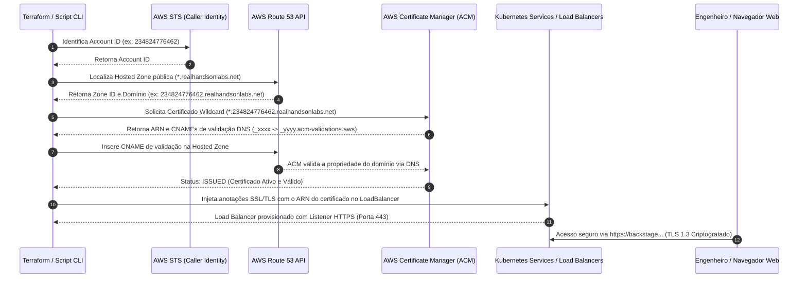

# Configuração de Route 53 e Certificado SSL/TLS no AWS ACM (Acesso HTTPS)

Este documento especifica a etapa automatizada que identifica a **Conta AWS**, descobre a **Hosted Zone pública do Route 53**, emite imediatamente um **Certificado SSL/TLS Wildcard no AWS Certificate Manager (ACM)**, realiza a validação via DNS e o associa aos Load Balancers para habilitar tráfego criptografado **HTTPS (Porta 443)** em todos os serviços da plataforma.

---

## 1. Fluxo de Execução Automatizado



---

## 2. Implementação no Terraform (`eks/dns_acm.tf`)

Assim que a infraestrutura base do EKS é inicializada, o Terraform obtém a identidade da conta AWS, localiza a hosted zone e provisiona o certificado ACM com validação DNS:

```hcl
# 1. Identidade da Conta AWS
data "aws_caller_identity" "current" {}

# 2. Descoberta da Hosted Zone Route 53
data "aws_route53_zones" "all" {}
data "aws_route53_zone" "all" {
  for_each = toset(data.aws_route53_zones.all.ids)
  zone_id  = each.value
}

locals {
  aws_account_id = data.aws_caller_identity.current.account_id
  lab_zones = [
    for z in data.aws_route53_zone.all : z
    if can(regex("realhandsonlabs\\.net", z.name)) && !z.private_zone
  ]
  has_lab_zone = length(local.lab_zones) > 0
  lab_zone_id  = local.has_lab_zone ? local.lab_zones[0].zone_id : ""
  lab_domain   = local.has_lab_zone ? trimsuffix(local.lab_zones[0].name, ".") : ""
}

# 3. Solicitação de Certificado Wildcard SSL/TLS
resource "aws_acm_certificate" "lab_cert" {
  count = local.has_lab_zone ? 1 : 0

  domain_name               = "*.${local.lab_domain}"
  subject_alternative_names = [local.lab_domain]
  validation_method         = "DNS"

  tags = {
    Name = "${local.lab_domain}-wildcard-cert"
  }

  lifecycle {
    create_before_destroy = true
  }
}

# 4. Registros CNAME de Validação DNS no Route 53
resource "aws_route53_record" "cert_validation" {
  for_each = local.has_lab_zone ? {
    for dvo in aws_acm_certificate.lab_cert[0].domain_validation_options : dvo.domain_name => {
      name   = dvo.resource_record_name
      record = dvo.resource_record_value
      type   = dvo.resource_record_type
    }
  } : {}

  allow_overwrite = true
  name            = each.value.name
  records         = [each.value.record]
  ttl             = 60
  type            = each.value.type
  zone_id         = local.lab_zone_id
}

# 5. Espera da Validação do Certificado
resource "aws_acm_certificate_validation" "lab_cert" {
  count = local.has_lab_zone ? 1 : 0

  certificate_arn         = aws_acm_certificate.lab_cert[0].arn
  validation_record_fqdns = [for r in aws_route53_record.cert_validation : r.fqdn]
}
```

---

## 3. Associação do Certificado ACM no Kubernetes Load Balancer

Para que os serviços do cluster escutem na **Porta 443 (HTTPS)** utilizando o certificado emitido, o Service do Kubernetes utiliza as seguintes anotações nativas da AWS:

### 3.1 Exemplo: Service do Kubernetes com ACM SSL/TLS

```yaml
apiVersion: v1
kind: Service
metadata:
  name: backstage-external
  namespace: backstage
  annotations:
    # Vincula o ARN do Certificado Wildcard gerado no ACM
    service.beta.kubernetes.io/aws-load-balancer-ssl-cert: "arn:aws:acm:us-east-1:234824776462:certificate/xxxx-xxxx"
    # Porta externa que receberá terminação SSL
    service.beta.kubernetes.io/aws-load-balancer-ssl-ports: "https"
    # Protocolo entre o Load Balancer e os Pods no cluster
    service.beta.kubernetes.io/aws-load-balancer-backend-protocol: "http"
    # Política de cifras seguras (TLS 1.2 e TLS 1.3)
    service.beta.kubernetes.io/aws-load-balancer-ssl-negotiation-policy: "ELBSecurityPolicy-TLS13-1-2-2021-06"
spec:
  type: LoadBalancer
  ports:
    - name: http
      port: 80
      targetPort: 7007
    - name: https
      port: 443
      targetPort: 7007
  selector:
    app: backstage
```

### 3.2 Exemplo: Ingress com AWS Load Balancer Controller (ALB)

```yaml
apiVersion: networking.k8s.io/v1
kind: Ingress
metadata:
  name: enterprise-platform-ingress
  annotations:
    kubernetes.io/ingress.class: alb
    alb.ingress.kubernetes.io/scheme: internet-facing
    alb.ingress.kubernetes.io/certificate-arn: "arn:aws:acm:us-east-1:234824776462:certificate/xxxx-xxxx"
    alb.ingress.kubernetes.io/listen-ports: '[{"HTTP": 80}, {"HTTPS": 443}]'
    alb.ingress.kubernetes.io/ssl-redirect: '443'
...
```

---

## 4. Endpoints Seguros Habilitados (HTTPS)

Com o certificado wildcard (`*.${lab_domain}`) ativo e validado, todos os serviços passam a responder de forma segura:

| Serviço | Endpoint HTTPS Seguro | Endpoint HTTP Legado |
|---|---|---|
| **Backstage IDP** | `https://backstage.<lab-id>.realhandsonlabs.net` | `http://backstage.<lab-id>...` |
| **ArgoCD GitOps** | `https://argocd.<lab-id>.realhandsonlabs.net` | `http://argocd.<lab-id>...` |
| **SonarQube** | `https://sonarqube.<lab-id>.realhandsonlabs.net` | `http://sonarqube.<lab-id>...` |
| **Grafana** | `https://grafana.<lab-id>.realhandsonlabs.net` | `http://grafana.<lab-id>...` |
| **Keycloak SSO** | `https://sso.<lab-id>.realhandsonlabs.net` | `http://sso.<lab-id>...` |
| **Python Flask App** | `https://python.<lab-id>.realhandsonlabs.net` | `http://python.<lab-id>...` |
| **.NET 8 C# App** | `https://dotnet.<lab-id>.realhandsonlabs.net` | `http://dotnet.<lab-id>...` |

---

## 5. Validação via CLI e Testes de Conectividade

```bash
# 1. Obter o ARN do Certificado emitido
aws acm list-certificates --query "CertificateSummaryList[?contains(DomainName, 'realhandsonlabs')].CertificateArn" --output text

# 2. Testar o Handshake TLS / HTTPS
curl -Iv https://backstage.<lab-id>.realhandsonlabs.net

# 3. Testar a validade do certificado SSL via OpenSSL
openssl s_client -connect backstage.<lab-id>.realhandsonlabs.net:443 -servername backstage.<lab-id>.realhandsonlabs.net </dev/null 2>/dev/null | openssl x509 -noout -dates -subject
```
