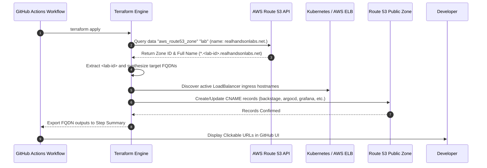

# Dynamic Route 53 DNS Delegation in Ephemeral AWS Sandboxes

This document details the automated dynamic DNS auto-discovery and delegation architecture implemented across the 4-repository ecosystem to support temporary, rotating AWS sandbox accounts.

---

## 1. The Ephemeral Sandbox Dilemma

In temporary cloud training environments (such as *RealHandsOnLabs*, *A Cloud Guru*, or *Cloud Academy*), AWS sandbox accounts are created on demand with a strict lifespan of 7 hours.

Each newly spawned AWS account comes provisioned with a pre-configured public Amazon Route 53 hosted zone whose name follows an unpredictable pattern:
```
<random-lab-id>.realhandsonlabs.net
```
For example:
- `lab-829104.realhandsonlabs.net.`
- `sandbox-41829.realhandsonlabs.net.`
- `294819.realhandsonlabs.net.`

### The Problem
Hardcoding domain names in Terraform, Kubernetes Ingress manifests, or application configuration files causes immediate failure on the next sandbox rotation, requiring tedious manual editing of dozens of YAML and `.tf` files.

### The Solution
A **Zero-Touch Dynamic DNS Engine** that:
1. Dynamically queries AWS Route 53 at runtime to find the active public hosted zone ending in `realhandsonlabs.net.`.
2. Extracts the unique `<lab-id>` prefix.
3. Automatically delegates friendly, descriptive CNAME and A records pointing to AWS Application Load Balancers, Network Load Balancers, or EC2 instances.
4. Outputs the complete directory of live URLs into GitHub Actions Step Summaries for instant developer access.

---

## 2. Dynamic Discovery Workflow



---

## 3. Terraform Dynamic Auto-Discovery Implementation

Across [`backstate-infra/terraform/dns.tf`](https://github.com/cirodasilvaj/backstage-infra) and [`samba-ad-keycloak/terraform/dns.tf`](https://github.com/cirodasilvaj/samba-ad-keycloak), the dynamic discovery is implemented as follows:

```hcl
# 1. Discover the active Route 53 public zone
data "aws_route53_zone" "lab" {
  name         = "realhandsonlabs.net."
  private_zone = false
}

# 2. Extract the canonical domain name and subsegment
locals {
  zone_id   = data.aws_route53_zone.lab.zone_id
  base_fqdn = trimsuffix(data.aws_route53_zone.lab.name, ".")
}

# 3. Dynamically create CNAME records for services
resource "aws_route53_record" "backstage" {
  zone_id = local.zone_id
  name    = "backstage.${local.base_fqdn}"
  type    = "CNAME"
  ttl     = 60
  records = [data.kubernetes_service.backstage.status[0].load_balancer[0].ingress[0].hostname]
}

resource "aws_route53_record" "grafana" {
  zone_id = local.zone_id
  name    = "grafana.${local.base_fqdn}"
  type    = "CNAME"
  ttl     = 60
  records = [data.kubernetes_service.grafana.status[0].load_balancer[0].ingress[0].hostname]
}

resource "aws_route53_record" "argocd" {
  zone_id = local.zone_id
  name    = "argocd.${local.base_fqdn}"
  type    = "CNAME"
  ttl     = 60
  records = [data.kubernetes_service.argocd.status[0].load_balancer[0].ingress[0].hostname]
}

resource "aws_route53_record" "sonarqube" {
  zone_id = local.zone_id
  name    = "sonarqube.${local.base_fqdn}"
  type    = "CNAME"
  ttl     = 60
  records = [data.kubernetes_service.sonarqube.status[0].load_balancer[0].ingress[0].hostname]
}
```

---

## 4. Complete Service DNS Directory

Once all deployment phases complete, the following standard service endpoints are actively mapped:

| Service Subdomain | Record Type | Target Destination | Authentication / Port | Notes |
|---|---|---|---|---|
| `backstage.<lab-id>.realhandsonlabs.net` | CNAME | AWS Ingress ELB | HTTP (80/7007) | Backstage Developer Portal & Catalog |
| `argocd.<lab-id>.realhandsonlabs.net` | CNAME | AWS Ingress ELB | HTTP / HTTPS (443) | ArgoCD GitOps Control Plane |
| `sonarqube.<lab-id>.realhandsonlabs.net` | CNAME | AWS Ingress ELB | HTTP (9000) | Static Code Analysis & Quality Gate |
| `grafana.<lab-id>.realhandsonlabs.net` | CNAME | AWS Ingress ELB | HTTP (3000) | Observability Dashboards & Telemetry |
| `sso.<lab-id>.realhandsonlabs.net` | CNAME | AWS Ingress ELB | HTTP (8080) | Keycloak 24 IAM & SAML/OIDC Broker |
| `keycloak.<lab-id>.realhandsonlabs.net` | CNAME | AWS Ingress ELB | HTTP (8080) | Keycloak Alternative Direct Alias |
| `ad.<lab-id>.realhandsonlabs.net` | A (Round-Robin) | EC2 Private IPs (`10.0.10.50`, `10.0.10.51`) | TCP 389 (LDAP) | Samba 4 Active Directory Multi-DC |
| `radius.<lab-id>.realhandsonlabs.net` | A | EC2 Private IP (`10.0.10.50`) | UDP 1812 (RADIUS) | FreeRADIUS Multi-Factor Auth (MFA) |
| `python.<lab-id>.realhandsonlabs.net` | CNAME | AWS Ingress ELB | HTTP (5000) | Python 3.12 Flask Microservice API |
| `dotnet.<lab-id>.realhandsonlabs.net` | CNAME | AWS Ingress ELB | HTTP (8080) | .NET 8 C# Enterprise Microservice |

---

## 5. DNS Synchronization Script (`sync-cluster-dns.sh`)

When Kubernetes LoadBalancer services are created, AWS asynchronously assigns DNS hostnames to the provisioned Elastic Load Balancers (ELBs). 

To prevent race conditions during rapid deployments, the automated synchronization script [`scripts/sync-cluster-dns.sh`](https://github.com/cirodasilvaj/backstage-infra/blob/main/scripts/sync-cluster-dns.sh) performs health polling:

```bash
#!/usr/bin/env bash
set -euo pipefail

echo "==> Auto-discovering Route 53 Hosted Zone ending in realhandsonlabs.net..."
ZONE_NAME=$(aws route53 list-hosted-zones-by-name \
  --dns-name "realhandsonlabs.net." \
  --query "HostedZones[?contains(Name, 'realhandsonlabs.net')].Name" \
  --output text | head -n 1)

ZONE_ID=$(aws route53 list-hosted-zones-by-name \
  --dns-name "realhandsonlabs.net." \
  --query "HostedZones[?contains(Name, 'realhandsonlabs.net')].Id" \
  --output text | head -n 1 | sed 's/\/hostedzone\///')

echo "==> Discovered Zone: ${ZONE_NAME} (ID: ${ZONE_ID})"

# Wait for LoadBalancer hostnames to resolve
SERVICES=("backstage:backstage:7007" "argocd:argocd-server:80" "sonarqube:sonarqube:9000" "grafana:grafana:3000")

for item in "${SERVICES[@]}"; do
  IFS=":" read -r SUBDOMAIN K8S_SVC PORT <<< "$item"
  echo "==> Fetching ELB hostname for ${K8S_SVC}..."
  
  ELB_HOSTNAME=""
  while [ -z "$ELB_HOSTNAME" ]; do
    ELB_HOSTNAME=$(kubectl get svc "$K8S_SVC" -o jsonpath='{.status.loadBalancer.ingress[0].hostname}' 2>/dev/null || true)
    [ -n "$ELB_HOSTNAME" ] && break
    echo "    Waiting for ELB assignment on ${K8S_SVC}..."
    sleep 5
  done

  RECORD_FQDN="${SUBDOMAIN}.${ZONE_NAME}"
  echo "==> Upserting Route 53 CNAME: ${RECORD_FQDN} -> ${ELB_HOSTNAME}"
  
  aws route53 change-resource-record-sets --hosted-zone-id "$ZONE_ID" --change-batch "{
    \"Changes\": [{
      \"Action\": \"UPSERT\",
      \"ResourceRecordSet\": {
        \"Name\": \"${RECORD_FQDN}\",
        \"Type\": \"CNAME\",
        \"TTL\": 60,
        \"ResourceRecords\": [{\"Value\": \"${ELB_HOSTNAME}\"}]
      }
    }]
  }"
done
```

---

## 6. Verification and Troubleshooting

### 6.1 Testing Public Resolution
To test that your local workstation resolves the dynamic records correctly:

```bash
# Query the CNAME of Backstage
dig +short CNAME backstage.<lab-id>.realhandsonlabs.net

# Query LDAP Round-Robin A records
dig +short A ad.<lab-id>.realhandsonlabs.net

# Test HTTP connectivity
curl -I http://backstage.<lab-id>.realhandsonlabs.net
curl -I http://python.<lab-id>.realhandsonlabs.net/metrics
curl -I http://dotnet.<lab-id>.realhandsonlabs.net/healthz
```

### 6.2 Common Issues & Solutions

1. **TTL Caching during rotation:**
   - Standard TTL is set to `60` seconds to prevent stale DNS records from remaining in local OS or router caches.
   - Flush local DNS cache if needed:
     ```bash
     sudo resolvectl flush-caches   # Ubuntu / Systemd-resolved
     sudo dscacheutil -flushcache   # macOS
     ```
2. **Zone Not Found:**
   - Verify that your active AWS credentials point to the current sandbox:
     ```bash
     aws sts get-caller-identity
     aws route53 list-hosted-zones
     ```
